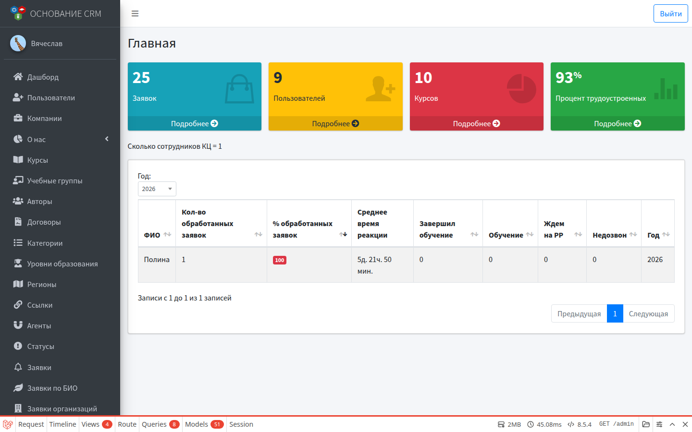
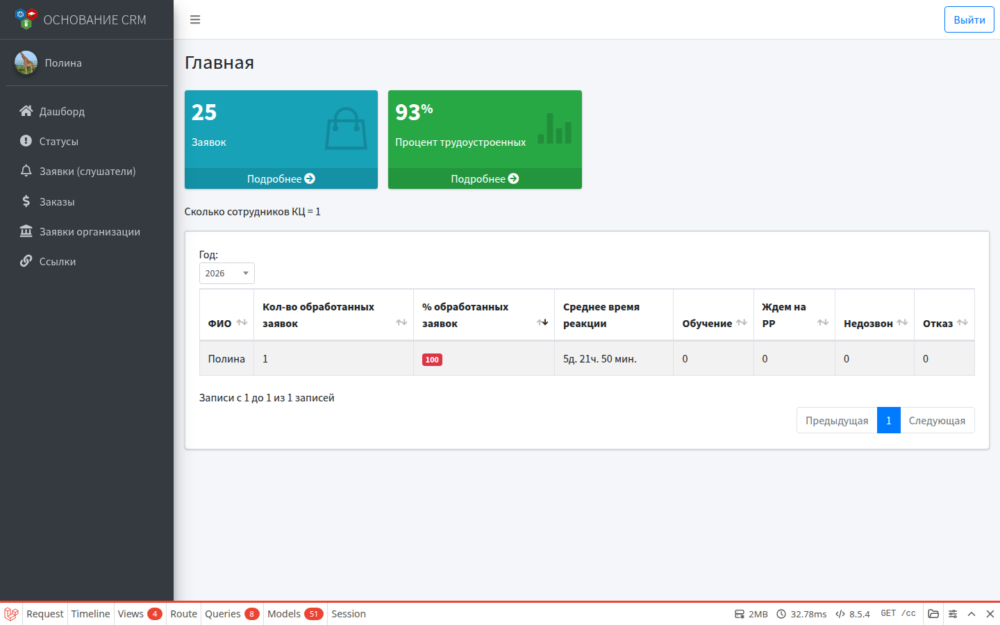
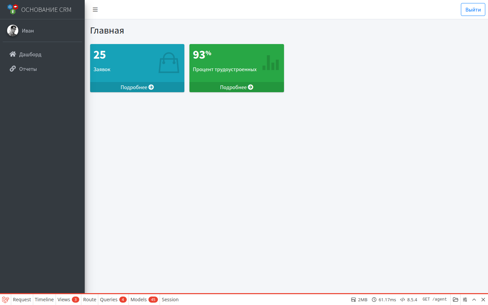
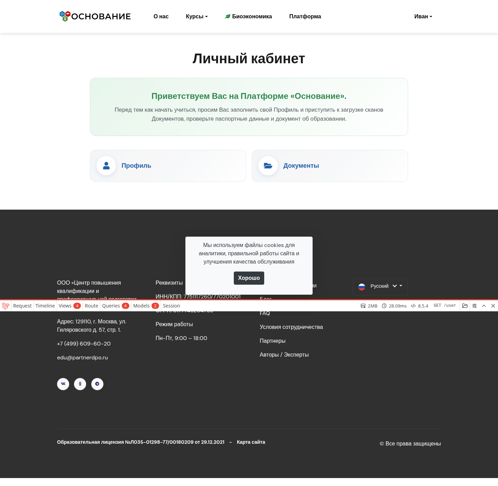
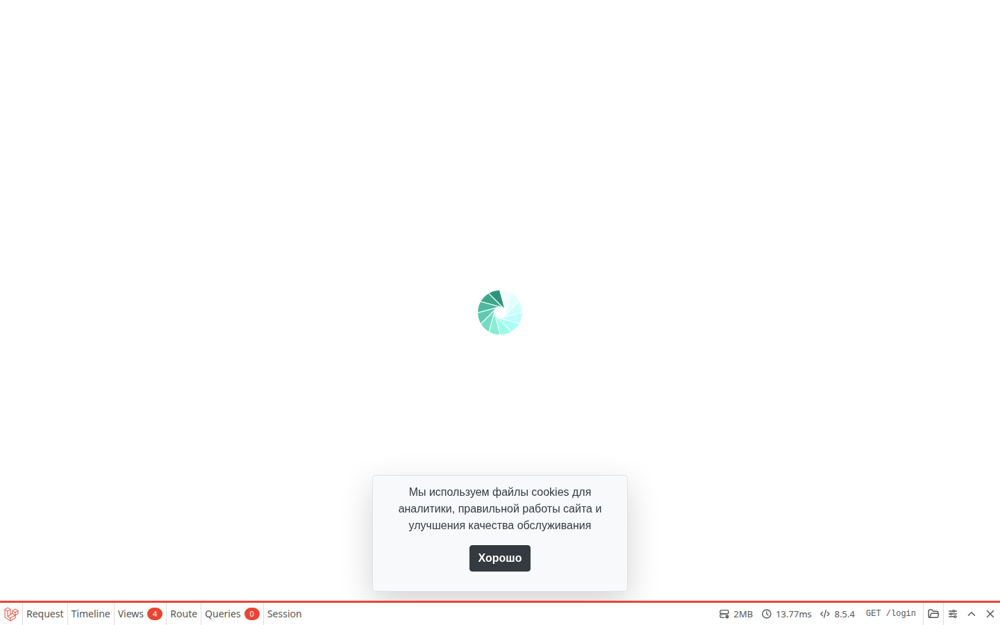

# Роли и вход в систему

## Зачем этот раздел

Понять, какая у вас роль, куда система отправит после входа и какие разделы вам доступны. Самостоятельная регистрация отключена: учётную запись создаёт администратор (или автоматика по заявке/заказу — см. модули позже).

## Роли

### Гость

Не авторизован. Видит публичный сайт: курсы, «О нас», формы заявок и заказ на платный курс. Кнопки **Войти** и **Оставить заявку** в шапке сайта.

### Администратор

Полный доступ к CRM (`/admin`). Меню слева: дашборд, пользователи, компании, «О нас», курсы, учебные группы, авторы, договоры, справочники, все типы заявок, заказы, отчёты, настройки.

### Специалист КЦ (контакт-центр)

Кабинет `/cc`. Работает с оперативкой, без справочников курсов и пользователей:

- Дашборд  
- Статусы  
- Заявки (слушатели)  
- Заказы  
- Заявки организации  
- Ссылки  

### Агент

Кабинет `/agent`: дашборд и **Отчёты** (своя сводка). После входа по умолчанию открывается отчёт.

### Пользователь (слушатель)

Личный кабинет `/user`: приветствие, переход к профилю и документам по заказу. Обычно создаётся администратором или в рамках учебного/заказного процесса.

---

## Вход в систему

### Предусловия

- Есть логин (email) и пароль, выданные администратором или присланные письмом.
- Браузер с доступом к сайту платформы.

### Шаги

1. Откройте сайт и нажмите **Войти** (или перейдите на страницу входа напрямую).

2. Введите email и пароль.
3. После успешного входа система сама направит вас:

| Роль | Куда попадёте |
| --- | --- |
| Администратор | `/admin` (дашборд CRM) |
| Агент | `/agent/report` (отчёты) |
| Специалист КЦ | `/cc/lid` (список заявок) |
| Пользователь | `/user` (личный кабинет) |

4. Чтобы выйти — используйте выход в меню пользователя / форме logout на сайте.

### Если не пускает

- Проверьте email и пароль; регистр и раскладка клавиатуры.
- Убедитесь, что открываете именно страницу входа платформы, а не чужой закладки.
- Если пароль забыт — обратитесь к администратору (сброс через штатную форму восстановления, если она включена на вашем стенде).
- Если после входа «пустая» или чужая зона — роль в карточке пользователя, скорее всего, задана неверно; правит только администратор в **Пользователи**.

---

## Переходы между кабинетом и сайтом

- Из CRM (админ / КЦ / агент) логотип «ОСНОВАНИЕ CRM» ведёт на публичную главную.
- Имя в боковой панели открывает **общий профиль** (`/profile`): имя, фамилия, аватар; email и телефон обычно только для просмотра.
- На публичном сайте у авторизованного пользователя в меню появляется переход в «свою» панель (админка / ЛК) и выход.

---

## Карта «роль → типичные задачи»

| Задача | Кто обычно делает |
| --- | --- |
| Завести курс, группу, настроить биоэкономику | Администратор |
| Разобрать входящую заявку слушателя | КЦ (и админ) |
| Провести заказ / оплату / статусы заказа | КЦ, админ |
| Посмотреть свой отчёт по привлечению | Агент |
| Загрузить документы по обучению | Пользователь (ЛК) |
| Оставить заявку с сайта | Гость |

Дальше по модулям — в [оглавлении](README.md).
