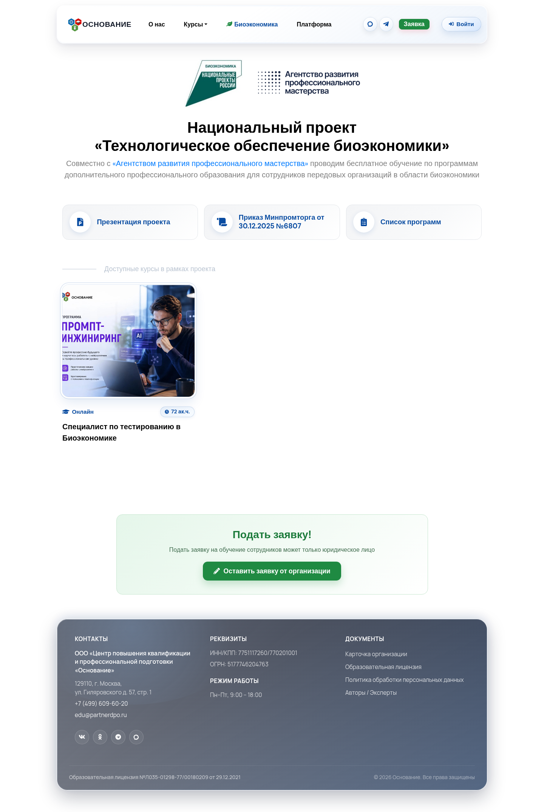
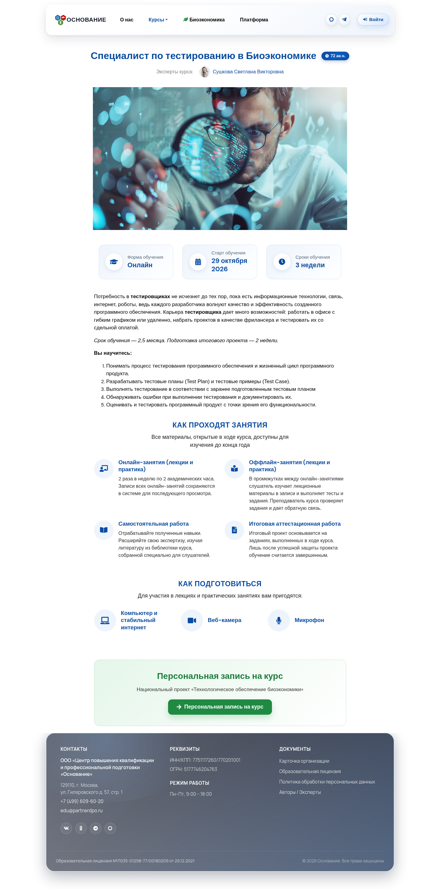
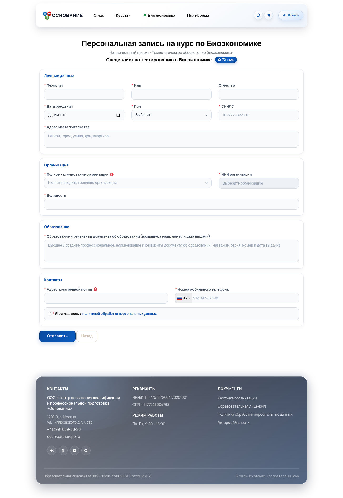
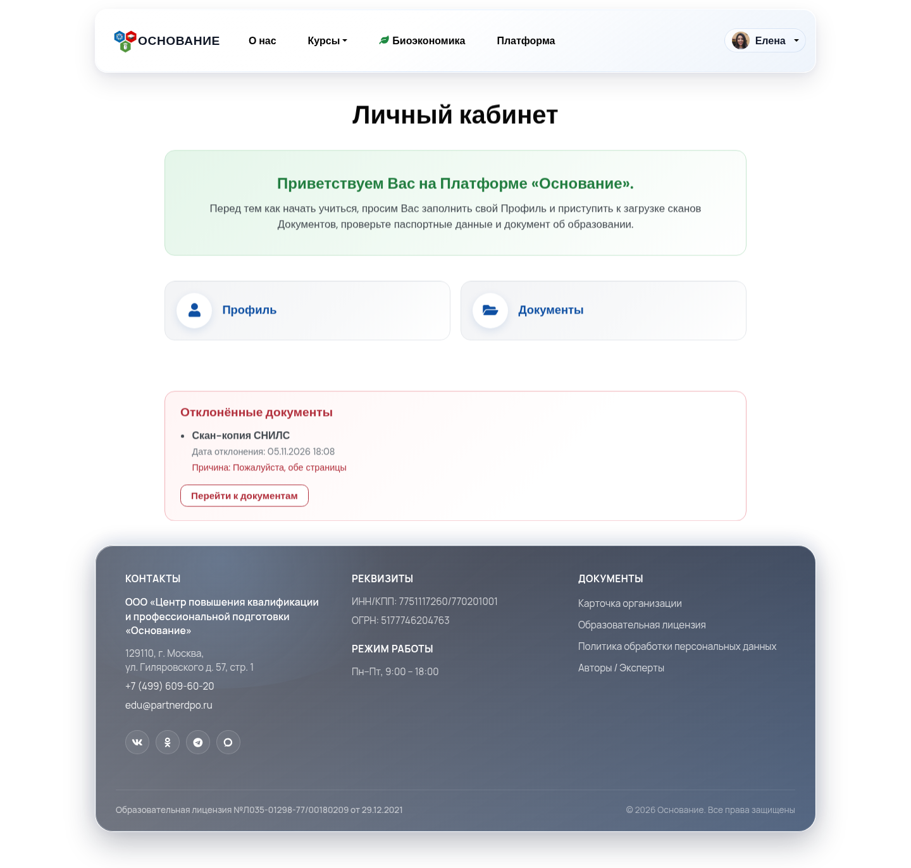
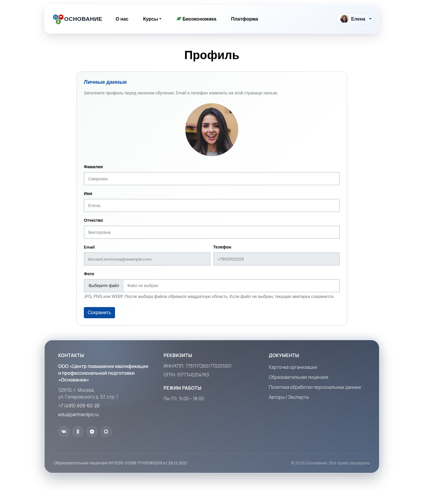
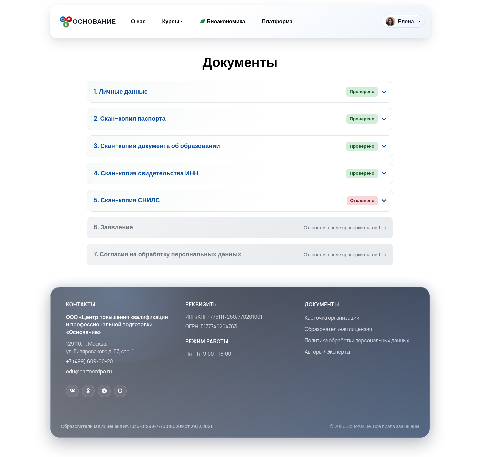

# Сценарий: заявка на БИО и документы по шагам

Пошаговая инструкция для **слушателя**: как подать личную заявку на курс биоэкономики и заполнить документы в личном кабинете.  
Также полезна администратору, КЦ и агенту — чтобы подсказать слушателю правильный порядок действий.

## Цель

Оформить личную заявку на курс БИО, получить доступ в личный кабинет и пройти все шаги проверки данных и документов.

## Предусловия

- На сайте опубликован курс биоэкономики с открытой записью.
- Для личной заявки нужна **личная** форма курса (не заявка от организации).
- После заявки у слушателя должна появиться учётка (письмо с логином/паролем или доступ от сотрудника).

> Заявка **от организации** (`/org/bioeconomy`) попадает в **Заявки организаций** и **не** открывает этот сценарий с документами в ЛК.

---

## Часть A. Подача личной заявки на сайте

1. Откройте раздел **Биоэкономика** (`/bioeconomy`).

2. Выберите нужный курс и откройте его карточку.

3. Нажмите кнопку записи / подачи **личной** заявки. Откроется форма `/lid/bioeconomy/{course}`.

4. Заполните обязательные поля (ФИО, контакты, организация, должность и др.) и отправьте форму.
5. Дождитесь страницы благодарности.

### Что происходит дальше

| Если в курсе включена автоматизация | Результат |
| --- | --- |
| Создавать пользователя | Появляется учётка слушателя, заявка привязывается к ней |
| Письмо «заявка принята» | Уходит уведомление на email |
| Письмо с логином и паролем | Приходит доступ в личный кабинет |
| Учебная группа | Слушатель может быть добавлен в группу курса |

Если письма нет — обратитесь к сотруднику (админ / КЦ / агент): учётку можно создать вручную в карточке **Заявки по БИО**.

---

## Часть B. Вход в личный кабинет

1. На сайте нажмите **Войти**.
2. Введите email и пароль из письма (или полученные от сотрудника).
3. После входа откроется личный кабинет `/user`.

4. Рекомендуется сразу открыть **Профиль** (`/profile`) и проверить ФИО / фото.

5. Перейдите в **Документы** (`/user/documents`).

Если видите сообщение, что заявка БИО не привязана к учётке — напишите сотруднику: нужна привязка заявки к пользователю.

---

## Часть C. Документы по шагам

Раздел документов — это цепочка шагов. Статусы у каждого шага:

| Статус | Что значит | Что делать |
| --- | --- | --- |
| Не отправлено | Ещё не отправили на проверку | Заполнить / загрузить и отправить |
| На проверке | Ждёт решения сотрудника | Ждать; повторно отправить нельзя |
| Проверено | Принято | Переходить к следующему шагу |
| Отклонено | Нужны правки (есть причина) | Исправить и отправить снова |

Форматы файлов: **PDF, JPG, PNG**, размер до **5 МБ**.

### Шаг 1. Личные данные

1. Откройте блок **1. Личные данные**.
2. Проверьте сведения из заявки (ФИО, контакты, организация, курс).
3. Заполните недостающее: адрес, паспортные данные, образование и диплом.
4. Нажмите **Отправить на проверку**.

Пока статус «На проверке» или «Проверено» — повторно отправить нельзя.  
После отклонения прочитайте причину, исправьте поля и отправьте снова.

### Шаги 2–5. Скан-копии документов

Загрузите по очереди:

| Шаг | Документ |
| --- | --- |
| 2 | Скан-копия паспорта |
| 3 | Скан-копия документа об образовании |
| 4 | Скан-копия свидетельства ИНН |
| 5 | Скан-копия СНИЛС |

Для каждого шага:

1. Раскройте блок.
2. Выберите файл.
3. Нажмите **Отправить на проверку**.
4. Дождитесь статуса **Проверено**.

Если документ отклонили — загрузите исправленный файл и отправьте снова.

> Шаги **6** и **7** откроются только после того, как шаги **1–5** все будут в статусе **Проверено**.

### Шаг 6. Заявление

1. Дождитесь открытия шага (после проверки шагов 1–5).
2. Нажмите **Скачать заявление** — в файле уже подставлены ваши данные.
3. Распечатайте, при необходимости дополните поля от руки, подпишите.
4. Загрузите скан или фото подписанного заявления.
5. Если диплом выдан на другую фамилию — дополнительно загрузите документ о смене фамилии.
6. Нажмите **Отправить на проверку**.

### Шаг 7. Согласия на обработку персональных данных

1. Скачайте оба шаблона:
   - согласие АРПМ;
   - согласие «Основание».
2. Распечатайте, подпишите от руки.
3. Загрузите сканы/фото обоих файлов.
4. Отправьте на проверку.

Оба согласия отправляются вместе.

---

## Часть D. Как понять, что всё готово

В списке шагов у блоков нет отклонений, а статусы:

1. Личные данные — **Проверено**  
2–5. Сканы — **Проверено**  
6. Заявление — **Проверено**  
7. Согласия — **Проверено**

Дальнейшее сопровождение (статусы заявки, обучение) ведёт сотрудник в CRM.

На главной ЛК при отклонениях может показываться блок **Отклонённые документы** с причиной и ссылкой вернуться к загрузке.

---

## Типичные ошибки

| Симптом | Что проверить |
| --- | --- |
| Нет доступа в ЛК после заявки | Нужна личная форма курса; org-заявка не создаёт этот поток. Проверьте письмо или попросите создать учётку |
| В документах «заявка не привязана» | В карточке заявки БИО нет пользователя — нужна привязка |
| Шаги 6–7 закрыты | Не все шаги 1–5 приняты |
| Нельзя отправить повторно | Статус «На проверке» или уже «Проверено» — ждите решения или исправляйте после отклонения |
| Файл не принимается | Формат не PDF/JPG/PNG или размер больше 5 МБ |
| Путаете с документами заказа | Документы платного заказа — отдельный раздел `/user/docs/{order}` |

---

## Связанные разделы

- [Личный кабинет слушателя](../modules/user-cabinet.md)  
- [Публичный сайт и формы](../modules/public-site.md)  
- [Заявки по БИО](../modules/biolids.md)  
- Сценарий для админа: [запуск курса по биоэкономике](bioeconomy-onboarding.md)  
