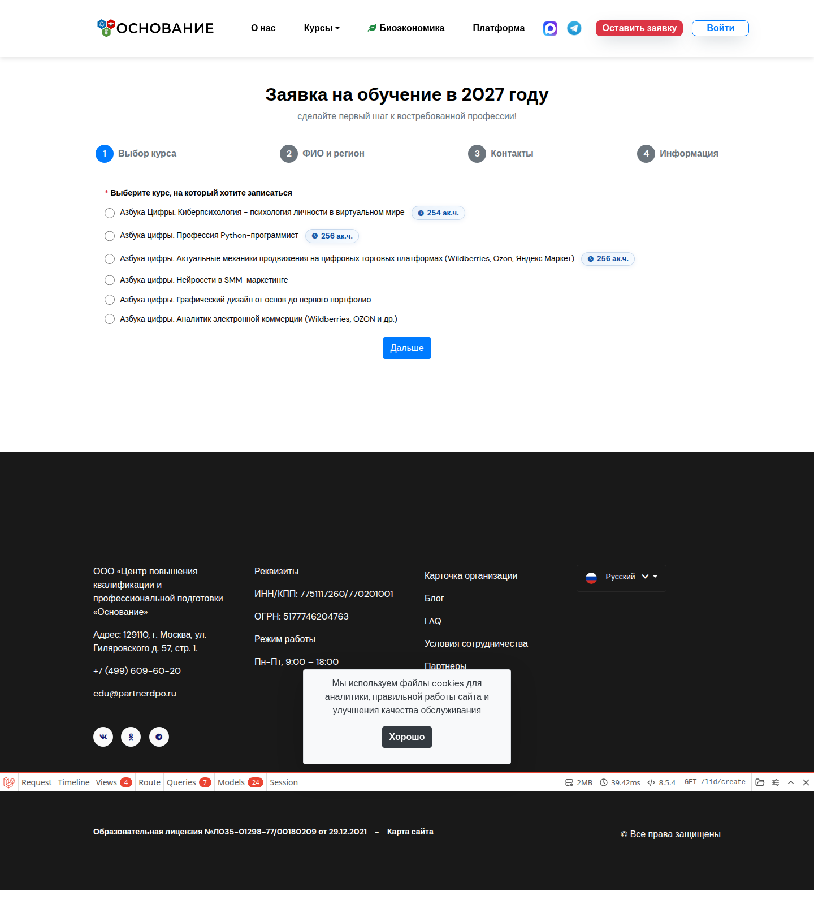
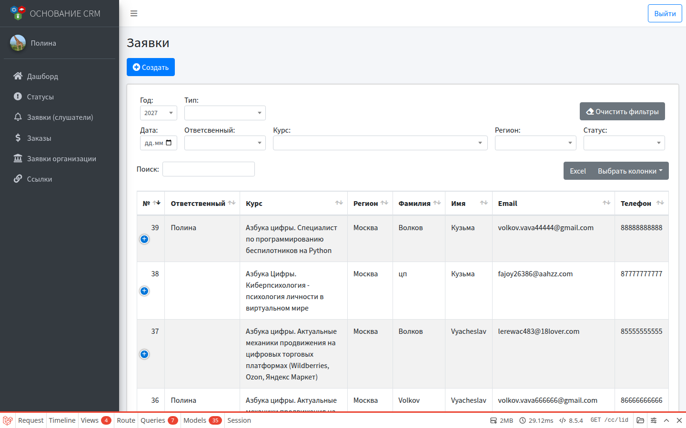
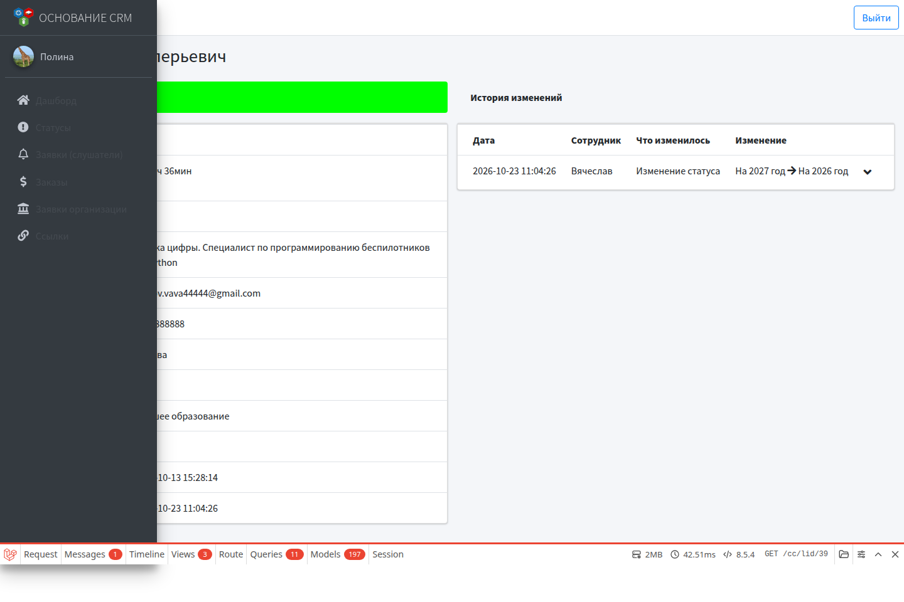
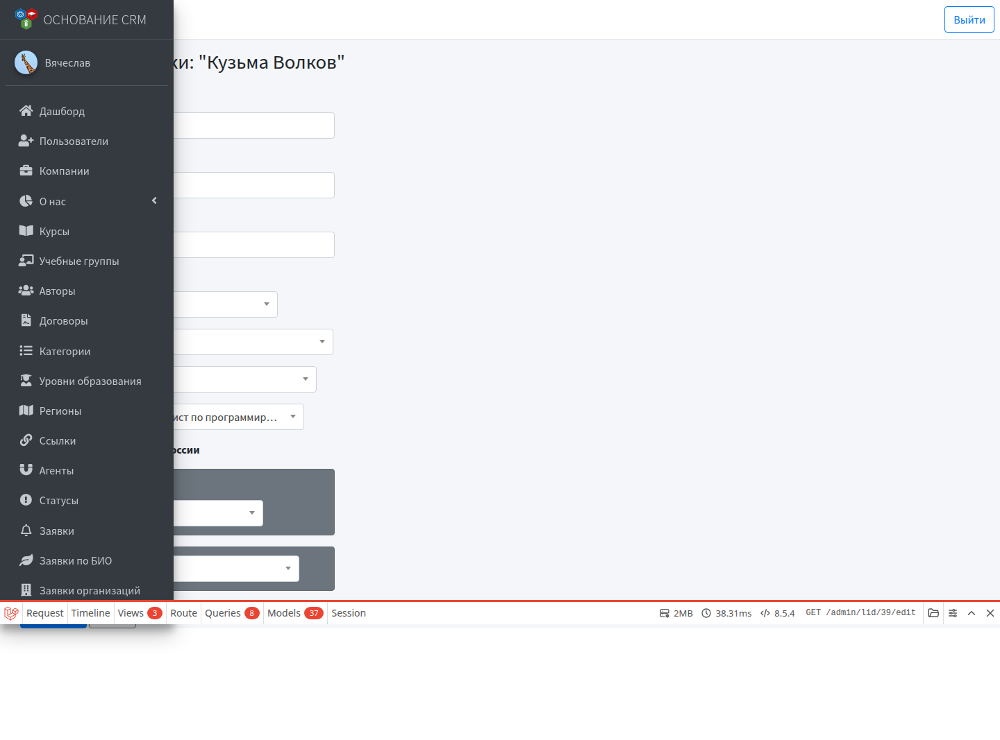

# Сценарий: обычная заявка с сайта до обработки в КЦ

Сквозной флоу личной заявки на (обычно бесплатное) обучение. Участники: **гость** → **специалист КЦ** или **администратор**.

Для биоэкономики см. отдельный сценарий: [Запуск курса по биоэкономике](bioeconomy-onboarding.md).

## Цель

Заявка с сайта появляется в CRM; сотрудник берёт её в работу, назначает ответственного и ведёт по статусам.

## Предусловия

- Курс существует, при необходимости открыта запись.
- У курса задан **статус по умолчанию** (для бесплатных — статус заявки).
- В справочнике **Статусы** есть нужные этапы обработки.
- У сотрудника есть доступ КЦ или админки.

---

## Часть A. Гость оставляет заявку

1. На сайте нажимает **Оставить заявку** или открывает форму курса (`/lid/create`, при необходимости с выбранным курсом).



2. Заполняет ФИО, контакты, курс, регион и прочие поля.
3. Отправляет форму (может быть капча — см. настройки форм).
4. Попадает на страницу благодарности; заявителю может уйти письмо о принятии заявки.

Альтернатива: сотрудник создаёт заявку вручную в **Заявки → Создать**.

---

## Часть B. Заявка в CRM

1. Открыть **Заявки** (КЦ) или **Заявки** (админ).



2. При необходимости отфильтровать по году, статусу «новые», курсу, региону.
3. Открыть карточку — проверить данные, время первой реакции.



Если заявки нет:

- это могла быть org-форма → **Заявки организаций**;
- или личная биоэкономика → **Заявки по БИО** (только админ);
- или платный поток → **Заказы**.

---

## Часть C. Обработка сотрудником

1. **Редактировать** заявку.



2. Назначить **ответственного** (себя или коллегу).
3. Сменить **статус** по регламенту; ввести комментарий в модальном окне.
4. При ошибках в данных — поправить поля и сохранить.
5. Повторять смену статусов до финального этапа.
6. При необходимости выгрузить набор заявок в **Excel**.

Подробнее: [Заявки (слушатели)](../modules/lids.md).

---

## Рядом: заявка организации

1. Гость заполняет `/org/create` или `/org/bioeconomy`.
2. Запись появляется в **Заявки организаций**.
3. КЦ/админ назначает ответственного и ведёт статусы так же (комментарий при смене статуса).

Подробнее: [Заявки организаций](../modules/orgs.md).

---

## Краткая схема

```text
Гость: /lid/create
    → Заявка в CRM (статус по умолчанию курса)
        → КЦ/админ: ответственный + статусы + комментарии
            → (по желанию) Excel-выгрузка
```
