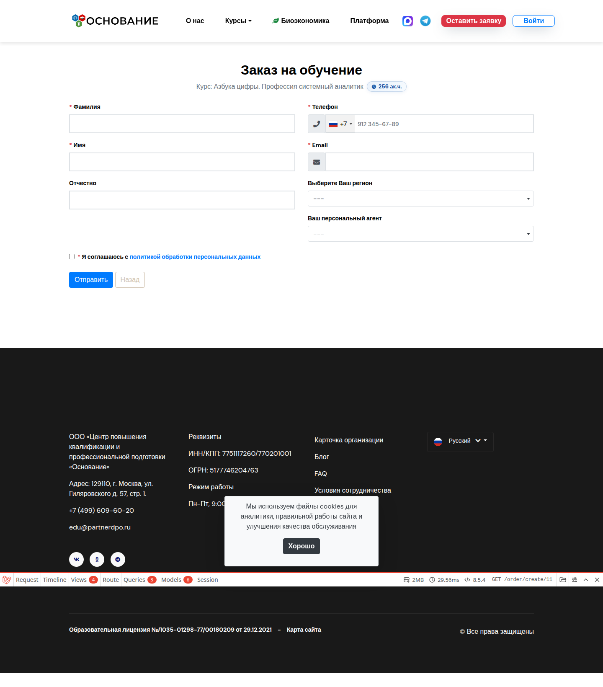
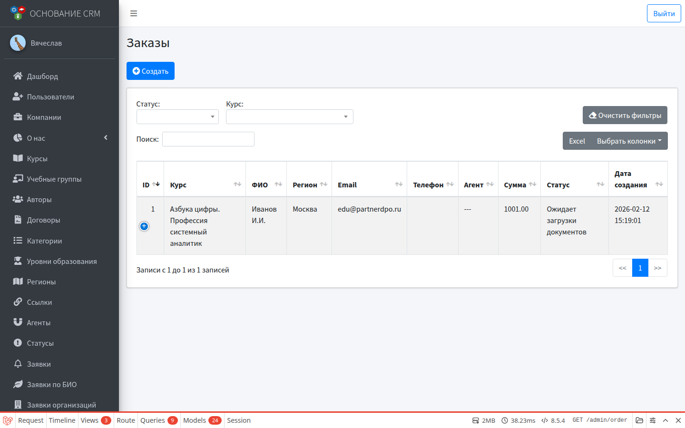
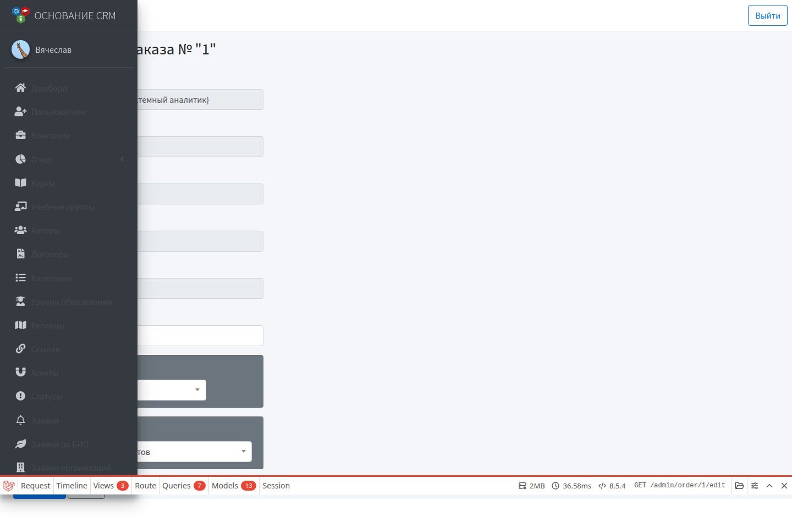

# Сценарий: платный заказ и документы слушателя

Сквозной флоу платной программы. Участники: **гость** → система создаёт **пользователя** и **заказ** → **КЦ/админ** ведёт заказ → слушатель работает в **личном кабинете**.

## Цель

Оформить заказ на платный курс, выдать доступ слушателю, провести заказ по статусам; слушатель при необходимости загружает документы в ЛК.

## Предусловия

- Курс платный: указана цена, открыта запись (если требуется витриной).
- В карточке курса выбран **статус по умолчанию** из статусов **заказов**.
- Почта на стенде работает (письма слушателю и сотрудникам).
- Для оплаты через ЮKassa — заданы ключи в окружении (если используется быстрая оплата).

---

## Часть A. Гость оформляет заказ

1. На сайте открывает платный курс → форма заказа `/order/create/{course}`.



2. Указывает ФИО, email, телефон, регион; при необходимости агента.
3. Отправляет форму.

### Что делает система

| Шаг | Результат |
| --- | --- |
| Пользователь | Создаётся учётка слушателя (роль «Пользователь»), если email свободен |
| Заказ | Создаётся с суммой = цена курса и статусом по умолчанию |
| Письма | Слушателю — доступ и данные заказа; сотрудникам — уведомление о новом заказе |

Если email уже занят или заказ на этот курс у пользователя уже есть, оформление может остановиться с сообщением — нужна ручная помощь администратора.

---

## Часть B. КЦ / админ ведёт заказ

1. **Заказы** → найти новый (фильтр по статусу/курсу).



2. Открыть карточку → **Редактировать**.



3. Назначить ответственного, при необходимости поправить сумму.
4. Менять статусы по регламенту (с комментарием).
5. Связаться со слушателем при проблемах с оплатой или данными.

Подробнее: [Заказы](../modules/orders.md).

---

## Часть C. Слушатель в личном кабинете

1. Входит по логину/паролю из письма (`/login` → `/user`).


2. В ЛК открывает документы по заказу / обучению и загружает файлы по инструкции кабинета.


3. Статусы проверки документов (для потоков, где это включено) смотрит в кабинете; для биоэкономики проверка идёт также в карточке **Заявки по БИО**.

Подробное описание экранов ЛК: [Личный кабинет слушателя](../modules/user-cabinet.md).

---

## Чек-лист проблем

| Симптом | Что проверить |
| --- | --- |
| Заказ не создался | Статус по умолчанию у курса; цена; открытость записи |
| Нет письма со доступом | Почта стенда; папка спам |
| Нет в списке заказов | Фильтры; заказ мог не сохраниться из‑за существующего email |
| Путаете с бесплатной заявкой | Бесплатные — **Заявки**; платные — **Заказы** |

---

## Краткая схема

```text
Гость: /order/create/{course}
    → User (слушатель) + Order (статус курса) + письма
        → КЦ/админ: ответственный, сумма, статусы
            → Слушатель: ЛК → документы
```
