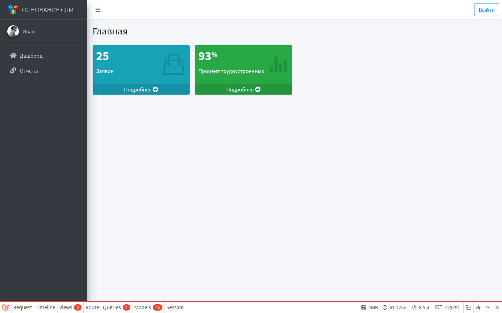
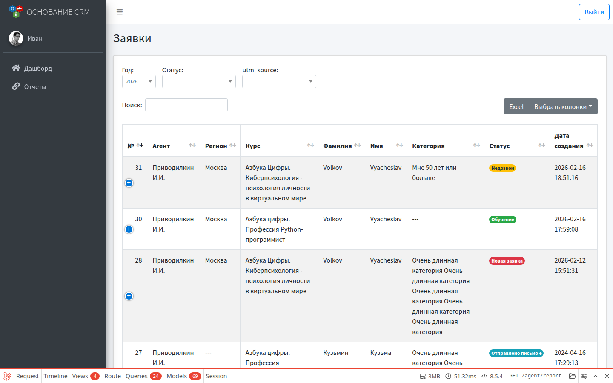

# Кабинет агента

**Кому:** пользователь с ролью **Агент**  
**Где:** `/agent` (после входа сразу **Дашборд**)

## Зачем кабинет

Смотреть заявки, связанные с вашими партнёрскими метками/агентами из справочника. Полной CRM (курсы, пользователи, статусы) у агента нет.

## Предусловия (делает администратор)

1. Создана учётка с ролью **Агент**.
2. В карточке пользователя привязаны записи из справочника **Агенты** и/или значения **utm_source**.
3. Для **Заявок по БИО** в карточке пользователя выбраны организации.
4. На формах/ссылках привлекают трафик с этими агентом или UTM, чтобы заявки попадали в выборку.

Без привязок отчёт будет пустым или почти пустым.

## Меню

| Пункт | Содержание |
| --- | --- |
| Дашборд | Сводка: число заявок по БИО и статусы документов (не отправлено / на проверке / отклонено / проверено) |
| Отчеты | Список «ваших» заявок с фильтрами (пункт виден, только если есть привязка к агенту и/или utm_source) |
| Заявки по БИО | Личные заявки биоэкономики: просмотр, статусы, проверка данных и документов — как у КЦ |

Профиль (имя, аватар) — по ссылке на имя в боковой панели (`/profile`), как у других ролей.

## Заявки по БИО

Раздел `/agent/biolid` — тот же функционал, что у специалиста КЦ: список, карточка, создание/редактирование, проверка данных и документов, создание учётки и отправка письма. Видны только заявки организаций, которые администратор привязал к агенту в карточке пользователя. Подробнее — [Заявки по БИО](biolids.md).

## Отчеты агента

### Какие заявки видны

Заявки, у которых:

- указан один из **привязанных агентов**, или  
- `utm_source` входит в список, заданный админом в карточке пользователя.

### Фильтры на экране

- год;
- статус;
- utm_source (из встречающихся в вашей выборке).

### Колонки

Номер, агент, регион, курс, поток, ФИО, категория, статус, дата, UTM-метки.

Редактировать заявки и менять статусы агент **не** может — только просмотр своего среза. Обработку ведут КЦ и администратор.

## Типичный день агента

1. Войти → на **Дашборде** проверить число заявок по БИО.
2. Открыть **Заявки по БИО** или **Отчеты**.
3. В отчётах выбрать год / статус / источник и проверить заявки по своим меткам.
4. При расхождениях — связаться с администратором (организации, привязки агентов/utm).

## Типичные ошибки

| Симптом | Что проверить |
| --- | --- |
| Пустой отчёт | Привязки в **Пользователи** → редактирование агента |
| Заявки «чужие» пропали | Так и задумано — видны только ваши агенты/utm |
| Пустой список Заявок по БИО | Админ не привязал организации в карточке пользователя |
| Путаете с справочником агентов | Справочник правит админ; вы смотрите следствия в отчёте |
| Нужно править статус заявки | Это делает КЦ в разделе **Заявки** |

## Связанные разделы

- [Пользователи](users.md) — как завести агента и привязки  
- [Отчёты](reports.md) — полный отчёт у админа  
- [Заявки по БИО](biolids.md) — работа с заявками биоэкономики  
- [Справочники](dictionaries.md) — справочник агентов  
- [Роли и вход](../00-roles-and-login.md)  
