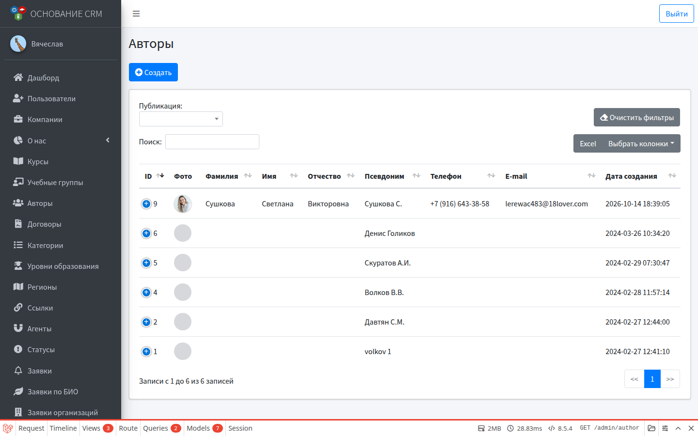
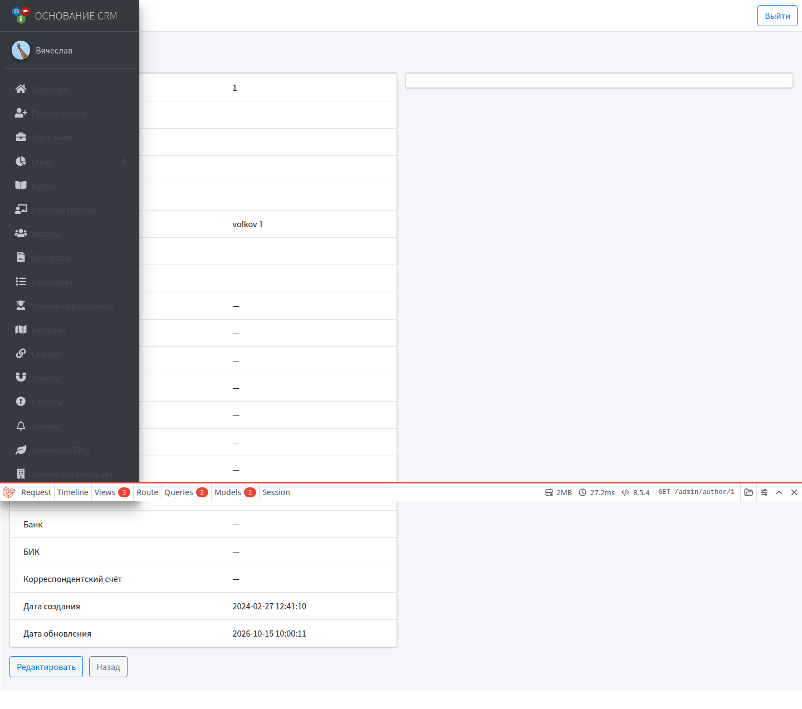
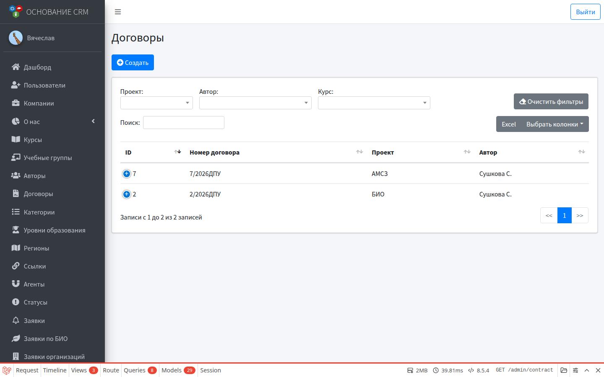
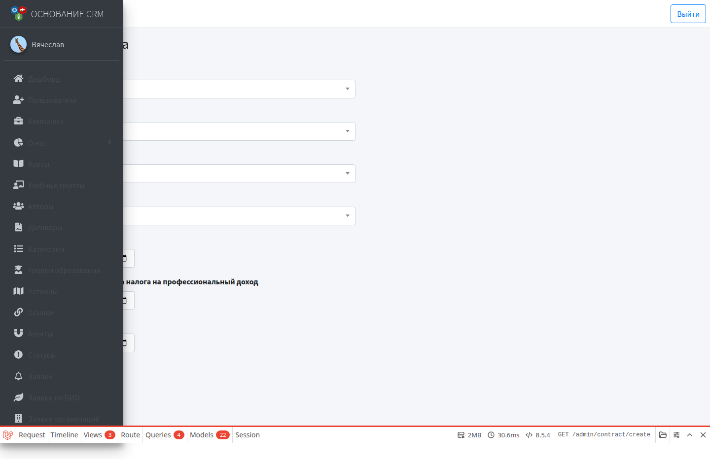
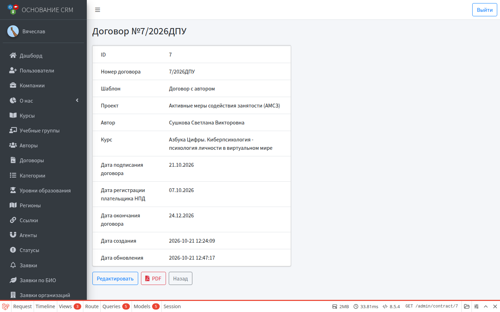

# Авторы и договоры

**Кому:** администратор  
**Меню:** Админка → **Авторы**, **Договоры** (проекты для договоров — в Настройках)

## Авторы

### Зачем

Карточки преподавателей/авторов курсов: для сайта (публикация) и для договоров (ФИО, паспорт, реквизиты).

### Список

Фильтр по публикации. В строке:

- фото, ФИО, псевдоним, контакты;
- переключатель **Публикация** (сразу на сайте / снять с публикации);
- просмотр, редактирование, **PDF** карточки автора, удаление.

### Создать / редактировать

1. **Авторы → Создать**.
2. Загрузите фото (при необходимости обрежьте).
3. Укажите фамилию, имя, отчество — **псевдоним** подставится автоматически.
4. Email, телефон.
5. Блок реквизитов: паспорт, адрес, банковские/налоговые данные — нужны для генерации договора.
6. Описание (для публичной страницы автора).
7. Сохраните; при необходимости включите публикацию в списке.

Автора можно привязать к курсу в карточке курса (поле авторов).

### PDF автора

Иконка PDF в списке или экспорт с карточки — выгрузка анкеты/данных автора для внутреннего использования.

---

## Договоры

### Зачем

Учёт договоров с авторами по проекту и курсу + скачивание PDF по шаблону.

### Предусловия

- Заведены **автор** (с реквизитами), **курс**, **проект** (Настройки → Проекты).
- Выбран шаблон из списка (настраивается в конфиге системы).

### Создать договор

1. **Договоры → Создать**.
2. Выберите **шаблон**, **проект**, **автора**, **курс**.
3. При необходимости укажите даты: подписания, регистрации плательщика НПД, окончания.
4. Сохраните — номер договора присвоится автоматически.

### Карточка договора

Показывает номер, шаблон, проект, автора, курс, даты.

Действия:

- **Редактировать** — сменить шаблон, проект, автора, курс, даты;
- **PDF** — скачать заполненный договор (данные автора, курса, формулировка проекта);
- удаление — из списка/карточки с подтверждением.

### Список

Фильтры: проект, автор, курс.

---

## Типичный флоу «договор с автором»

1. Создать/дозаполнить автора (паспорт и реквизиты).
2. Убедиться, что курс и проект есть.
3. Создать договор → проверить данные на карточке → скачать **PDF**.
4. При смене формулировки проекта править **Проект** (поле «Формулировка в договоре») и перегенерировать PDF.

---

## Типичные ошибки

- PDF «кривой» или пустые поля → у автора не заполнены реквизиты / у проекта пустая формулировка.
- Нет автора в списке договора → автор ещё не создан.
- Автор не виден на сайте → выключена публикация.

## Связанные разделы

- [Курсы](courses.md)  
- [Настройки](settings.md) (проекты)  
- [Справочники](dictionaries.md)  
