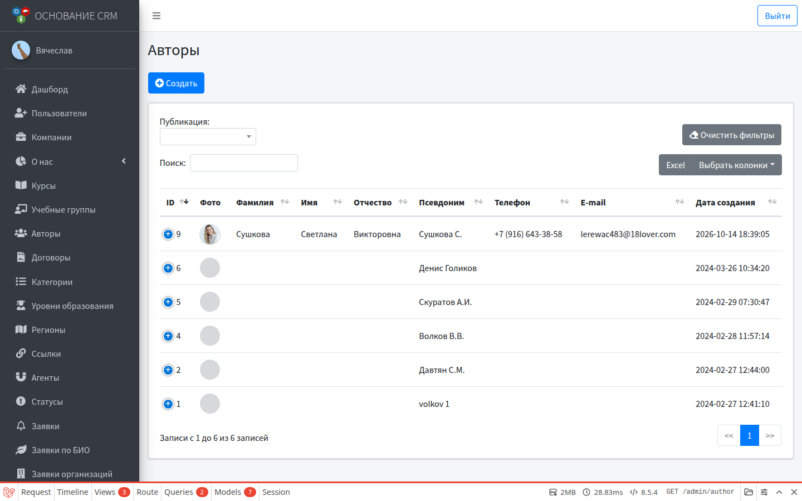
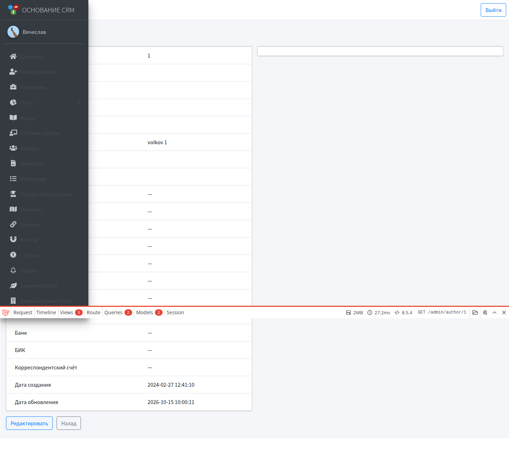
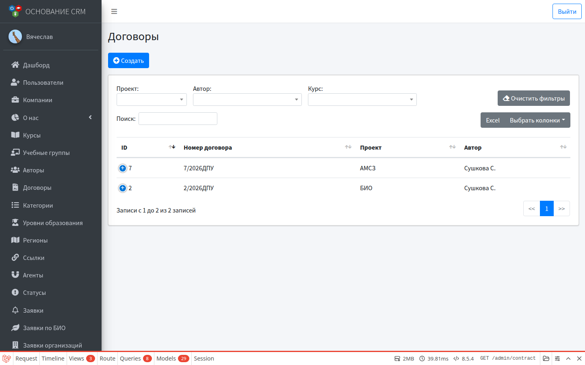
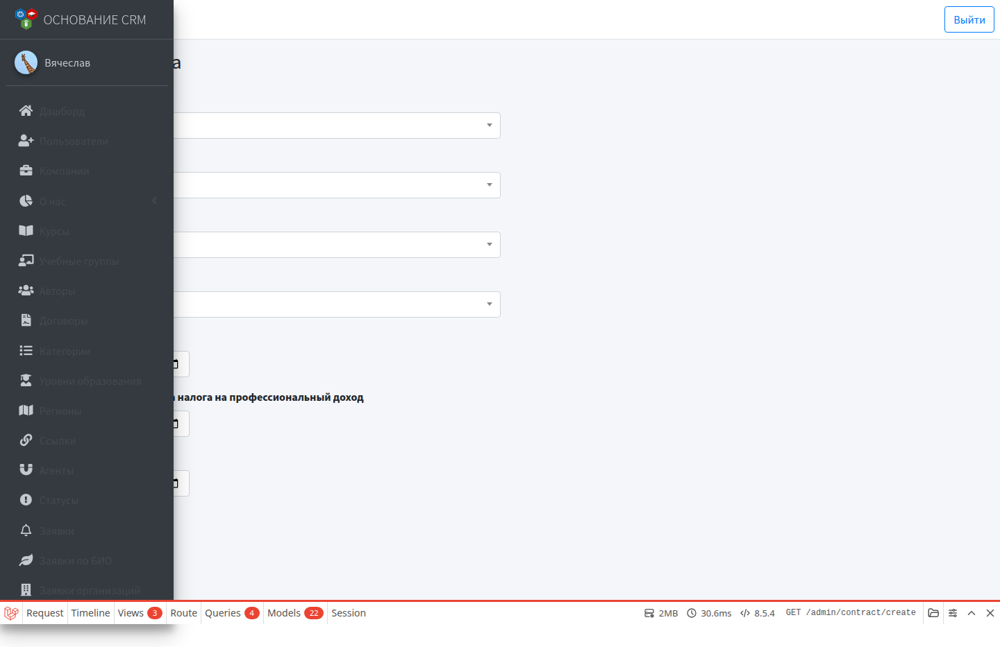
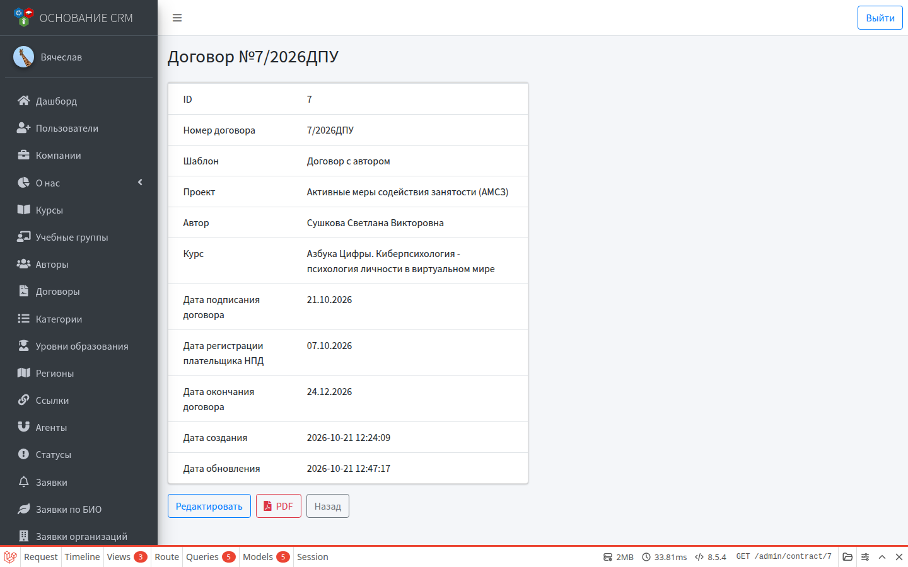

# Авторы и договоры

**Кому:** администратор  
**Меню:** Админка → **Авторы**, **Договоры** (проекты для договоров — в Настройках)

## Авторы

### Зачем

Карточки преподавателей/авторов курсов: для сайта (публикация) и для договоров (ФИО, паспорт, реквизиты).

### Список

Фильтр по публикации. В строке:

- фото, ФИО, псевдоним, контакты;
- переключатель **Публикация** (сразу на сайте / снять с публикации);
- просмотр, редактирование, **PDF** карточки автора, удаление.

### Создать / редактировать

1. **Авторы → Создать**.
2. Загрузите фото (при необходимости обрежьте).
3. Укажите фамилию, имя, отчество — **псевдоним** подставится автоматически.
4. Email, телефон.
5. Блок реквизитов: паспорт, адрес, банковские/налоговые данные — нужны для генерации договора.
6. Описание (для публичной страницы автора).
7. Сохраните; при необходимости включите публикацию в списке.

Автора можно привязать к курсу в карточке курса (поле авторов).

### PDF автора

Иконка PDF в списке или экспорт с карточки — выгрузка анкеты/данных автора для внутреннего использования.

---

## Договоры

### Зачем

Учёт договоров с авторами по проекту и курсу + скачивание PDF по шаблону.

### Предусловия

- Заведены **автор** (с реквизитами), **курс**, **проект** (Настройки → Проекты).
- Выбран шаблон из списка (настраивается в конфиге системы).

### Создать договор

1. **Договоры → Создать**.
2. Выберите **шаблон**, **проект**, **автора**, **курс**, **статус** (Проект / На подписании / Подписан / Оригинал).
3. При необходимости укажите даты: подписания, регистрации плательщика НПД, окончания.
4. Сохраните — номер договора присвоится автоматически.

### Карточка договора

Показывает номер, шаблон, проект, автора, курс, даты.

Действия:

- **Редактировать** — сменить шаблон, проект, автора, курс, даты;
- **PDF** — скачать заполненный договор (данные автора, курса, формулировка проекта) вместе с Приложением №1 (форма Отчёта), Приложением №2 (форма Акта) и согласием на обработку персональных данных;
- **Создать задание** — добавить задание к договору;
- **Создать отчёт** — если есть задание без отчёта (с выбором задания);
- удаление — из списка/карточки с подтверждением.

На карточке также списки заданий и отчётов с просмотром, редактированием и PDF.

### Задания к договору

К одному договору можно создать несколько заданий (номера 1, 2, 3… назначаются автоматически).

При создании укажите:

- учебную группу (поток курса договора);
- виды работ — отметьте один или несколько предустановленных пунктов (для занятий и проверки тетради можно указать ссылки; есть пункт со своим текстом);
- статус (Проект / На подписании / Подписан / Оригинал);
- стоимость академического часа;
- дату задания;
- срок оказания услуг (с / по).

На карточке задания: **Редактировать**, отдельный **PDF** задания, **Создать отчёт** (или ссылка на существующий — один отчёт на задание), **Создать акт**, удаление. В PDF подставляются данные договора/автора/курса, выбранная группа с датами обучения, ставка и сумма прописью.

### Отчёты к заданию

К каждому заданию — не больше одного отчёта. Создать можно с карточки договора (выбор задания без отчёта) или с карточки задания.

При создании/редактировании:

- номер отчёта (по умолчанию = номер задания);
- статус (те же, что у договора/задания);
- дата отчёта;
- срок оказания услуг (с / по; по умолчанию из задания);
- количество акад. часов.

На карточке отчёта: **Редактировать**, **PDF** и **DOCX** по форме Приложения №1 (данные договора, задания, автора, курса и часы), удаление.

### Акты к заданию

К заданию можно создать несколько актов. Создание — с карточки договора (выбор задания) или задания.

При создании/редактировании:

- номер акта (автоинкремент внутри договора, редактируемый);
- статус;
- дата акта;
- стоимость услуг (по умолчанию ставка задания × часы из отчёта, можно изменить).

На карточке акта: **Редактировать**, **PDF** и **DOCX** по форме Приложения №2, удаление. В списке договоров — колонка статусов актов.

### Список

Фильтры: проект, автор, курс.

---

## Типичный флоу «договор с автором»

1. Создать/дозаполнить автора (паспорт и реквизиты).
2. Убедиться, что курс и проект есть; у курса есть нужная учебная группа.
3. Создать договор → проверить данные на карточке → скачать **PDF**.
4. При необходимости создать **задание** → заполнить параметры → скачать **PDF** задания.
5. После оказания услуг создать **отчёт** к заданию → указать часы → скачать **PDF** / **DOCX** отчёта.
6. Создать **акт** (сумма подставится из ставки × часов отчёта) → скачать **PDF** / **DOCX** акта.
7. При смене формулировки проекта править **Проект** (поле «Формулировка в договоре») и перегенерировать PDF.

---

## Типичные ошибки

- PDF «кривой» или пустые поля → у автора не заполнены реквизиты / у проекта пустая формулировка.
- Нет автора в списке договора → автор ещё не создан.
- Автор не виден на сайте → выключена публикация.

## Связанные разделы

- [Курсы](courses.md)  
- [Настройки](settings.md) (проекты)  
- [Справочники](dictionaries.md)  
