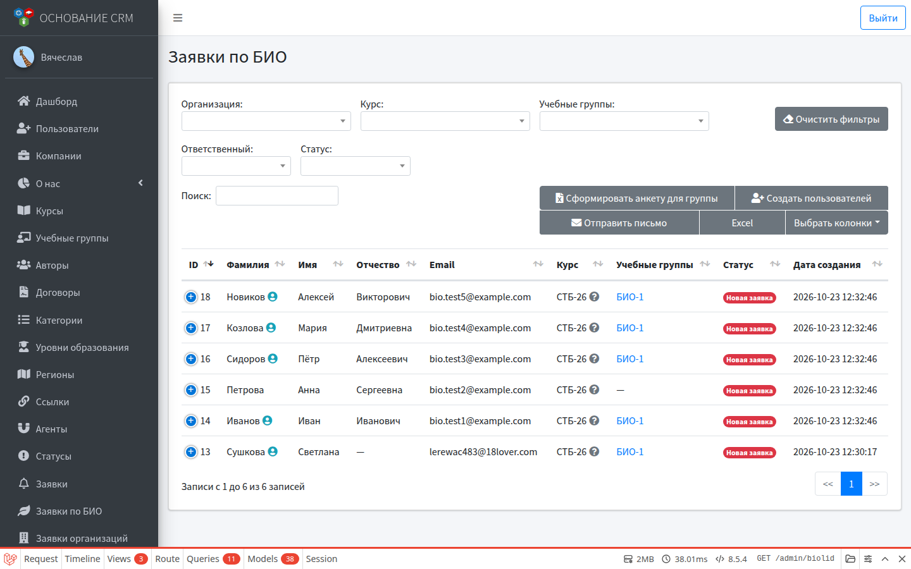
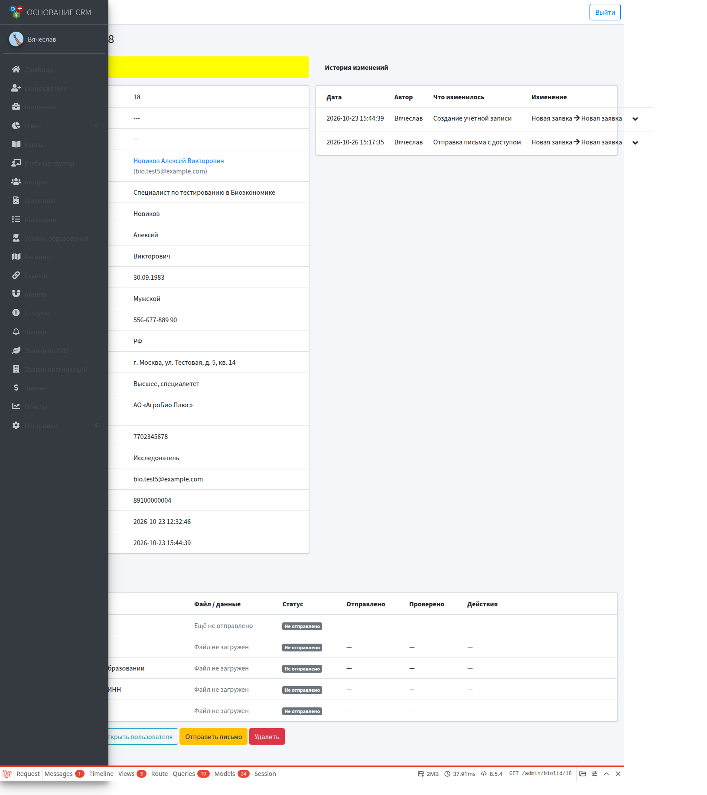

# Заявки по БИО

**Кому:** администратор  
**Меню:** Админка → **Заявки по БИО**

> Специалист КЦ этот раздел **не** видит. Обычные заявки слушателей у КЦ — в **Заявки (слушатели)**; заявки организаций биоэкономики попадают в **Заявки организаций**, а не сюда.

## Зачем раздел

Личные заявки на курсы биоэкономики (`BioLid`): карточка слушателя, статус, привязка к пользователю, проверка данных и документов, выгрузки и массовые действия.

Заявка появляется, когда гость отправляет **личную** форму на сайте: раздел биоэкономики → конкретный курс (`/bioeconomy/{course}`). Автоматизация при создании зависит от настроек **этого курса**.

Заявка организации с формы `/org/bioeconomy` создаёт запись в **Заявках организаций**, а не в этом списке.

## Список заявок

Фильтры сверху:

- организация;
- курс;
- учебные группы (по группам пользователя заявки);
- ответственный, статус (ниже по форме списка).

Фильтры запоминаются. Кнопка **Очистить фильтры** сбрасывает их.

### Кнопки над таблицей (по текущим отфильтрованным строкам)

| Действие | Что делает |
| --- | --- |
| Сформировать анкету для группы | Excel-выгрузка по заявкам из фильтра |
| Создать пользователей | Для заявок без учётки (или с привязкой по email): создать/привязать пользователя; опционально записать в учебную группу. **Письма с доступом не отправляются** |
| Отправить письмо | Массово отправить письма с логином и паролем заявкам, у которых уже есть пользователь (пароль при этом обновляется) |

Сначала отфильтруйте нужный набор (например, один курс и одна группа), затем нажимайте действие.

## Карточка заявки

Показывает ФИО, контакты, организацию, курс, статус, связанного пользователя, историю изменений.

### Документы и проверка

Блок **Документы и проверка**:

1. Данные заявки по БИО — принять или отклонить (при отклонении укажите причину).  
2. Далее — необходимые файлы из личного кабинета слушателя: скачать, принять или отклонить с комментарием.

Слушатель видит статусы проверки в своём ЛК (когда привязана учётка).

### Действия внизу карточки

| Кнопка | Когда | Результат |
| --- | --- | --- |
| Редактировать | всегда | Правка полей заявки и курса |
| Создать учётную запись | нет привязанного пользователя | Создаёт нового пользователя по email или привязывает существующего; **в группу автоматически не пишет** (это делает автоматика курса при создании заявки или массовое действие) |
| Открыть пользователя / Отправить письмо | пользователь уже есть | Письмо с **новым** паролем на email |
| Удалить | всегда | Удаление заявки с подтверждением |

## Что происходит «само» при заявке с сайта

Если в курсе включена автоматизация (см. [Курсы](courses.md)):

1. При необходимости уходит письмо «заявка принята».
2. Если включено создание пользователя — создаётся или находится пользователь по email, заявка привязывается к нему.
3. Если выбрана учебная группа — пользователь добавляется в группу.
4. Если включено письмо с доступом — уходит логин и пароль (для уже существующего пользователя пароль перевыпускается).

Ошибки почты или создания учётки не должны ломать сохранение заявки: заявка остаётся в списке, недостающие шаги можно доделать вручную кнопками выше.

## Типичные ошибки

- Заявки нет в списке БИО, хотя форму заполняли → это могла быть **организационная** форма или обычная заявка не по биоэкономике.
- Пользователь создан, но не в группе → в курсе не была выбрана группа на момент заявки; добавьте через массовое «Создать пользователей» с группой или в карточке пользователя.
- «Отправить письмо» не срабатывает → сначала нужна учётка; проверьте почтовый сервис.
- Массовое создание пишет «0», а заявки с пользовательями уже есть → действие создаёт только недостающие привязки; для писем используйте отдельную кнопку.

## Связанные разделы

- [Курсы](courses.md)  
- [Учебные группы](study-groups.md)  
- Сценарий: [Запуск курса по биоэкономике](../flows/bioeconomy-onboarding.md)  
- Настройки документов на публичной странице БИО: Админка → Настройки → **Биоэкономика** (отдельный модуль настроек — позже)  
