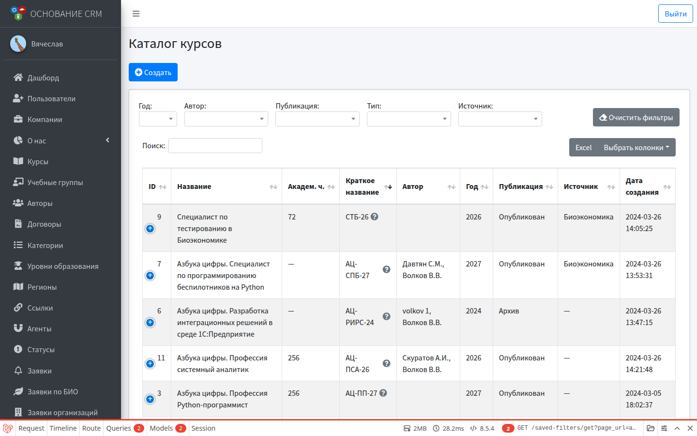
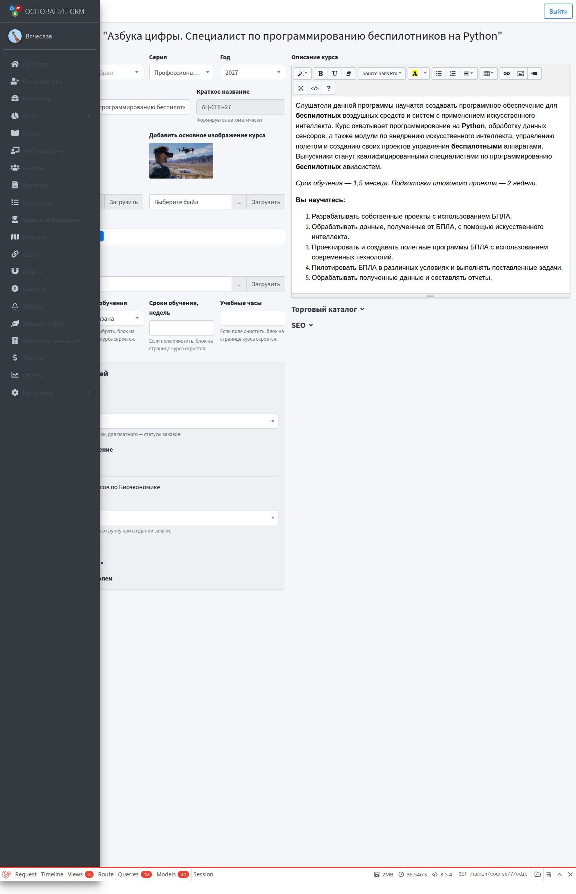

# Курсы

**Кому:** администратор  
**Меню:** Админка → **Курсы**

## Зачем раздел

Каталог программ обучения: карточки на сайте, тип (бесплатный/платный), публикация, запись, статусы заявок/заказов по умолчанию. Для программ биоэкономики здесь же включается автоматизация заявок.

## Основные понятия

| Поле / переключатель | Смысл |
| --- | --- |
| Название | Полное название на сайте и в CRM |
| Краткое название | Формируется автоматически из названия и года; удобно в списках и фильтрах |
| Тип | Повышение квалификации / профпереподготовка / профобучение |
| Компания, серия, год | Привязка к организации-провайдеру и набору |
| Открыть запись на обучение | Можно ли подавать заявки/заказы на курс |
| Биоэкономика | Курс попадает в раздел биоэкономики; открывает блок автоматизации |
| Статус по умолчанию | Для бесплатного — статус заявки, для платного — статус заказа |
| Торговый каталог | Цена и поля платного курса |

## Создать курс

### Предусловия

Нужны компания (и при необходимости серия, год, авторы, статусы) в справочниках.

### Шаги

1. **Курсы** → создать курс.
2. Заполните компанию, тип, название (обязательно), описание, изображения по правилам формы.
3. При необходимости задайте форму обучения, недели, часы, дату старта, авторов.
4. Если курс должен принимать заявки — включите **Открыть запись на обучение**.
5. Для биоэкономики включите **Биоэкономика**. На этапе создания выбрать учебную группу ещё нельзя: сначала сохраните курс, создайте группу, затем вернитесь в редактирование.
6. Сохраните.

## Отредактировать курс и автоматизацию БИО

1. **Курсы** → нужный курс → редактировать.

2. При включённой **Биоэкономике** появится блок **Автоматизация заявок для курсов по Биоэкономике**:

| Настройка | Что делает при новой личной заявке с сайта |
| --- | --- |
| Учебная группа для заявок | Добавляет созданного/найденного пользователя в эту группу |
| Создавать пользователя | Создаёт учётку слушателя (роль «Пользователь») или привязывает существующую по email |
| Письмо «заявка принята» | Письмо-подтверждение на email заявки |
| Письмо с логином и паролем | Письмо с доступом в ЛК (нужно включённое создание пользователя) |

3. В списке групп — **только группы этого курса** (у группы должен быть выбран этот курс). Если список пуст — создайте группу и привяжите курс.
4. Важно: группу или письмо с доступом нельзя включить без **Создавать пользователя** — форма не сохранится.
5. Нажмите **Обновить**.

## Типичные ошибки

- В селекте группы пусто → группа не привязана к этому курсу или курс ещё не сохранён.
- Хотите и группу, и письмо с паролем, но без создания пользователя → система потребует включить создание пользователя.
- Курс не виден в биоэкономике на сайте → не включён переключатель **Биоэкономика** и/или не открыта запись (проверьте публикацию и настройки списка на сайте).

## Связанные разделы

- [Учебные группы](study-groups.md)  
- [Заявки по БИО](biolids.md)  
- Сценарий: [Запуск курса по биоэкономике](../flows/bioeconomy-onboarding.md)  
