# Справочники

**Кому:** в основном администратор; **статусы** и **ссылки** также есть у специалиста КЦ  
**Меню:** пункты бокового меню CRM (см. ниже)

## Зачем раздел

Общие списки, от которых зависят формы заявок, фильтры, курсы и письма. Менять осторожно: удаление статуса или региона, который уже используется, ломает отображение старых записей.

---

## Статусы

**Меню:** Админка / КЦ → **Статусы**

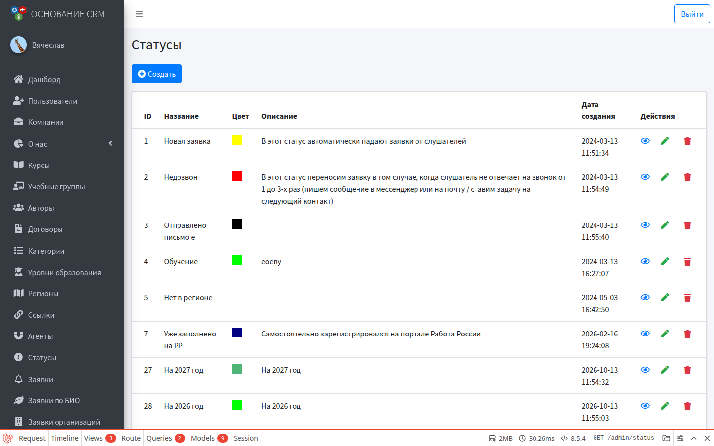

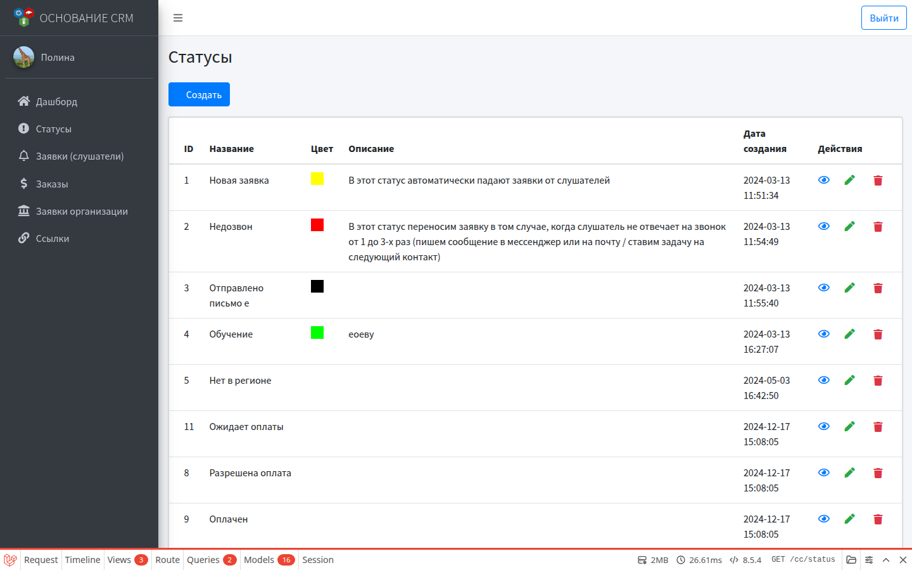

Два семейства в базе:

| Семейство | Признак | Где используется |
| --- | --- | --- |
| Заявки (слушатели, org и т.п.) | Тип пустой | **Заявки**, org; статус по умолчанию у **бесплатного** курса |
| Заказы | Тип `order`, часто с **кодом** | **Заказы**; статус по умолчанию у **платного** курса; кнопки в ЛК (`payment-allowed`, `waiting-documents` и др.) |

В форме создания/редактирования задаются **название**, **цвет**, **описание**. Тип и код через обычную форму UI не меняются — их задают при внедрении/миграциях. Не удаляйте статусы заказов с кодами, на которых завязана оплата и документы в ЛК.

Создание нового статуса через UI подходит для этапов обработки заявок.

---

## Ссылки

**Меню:** Админка / КЦ → **Ссылки**

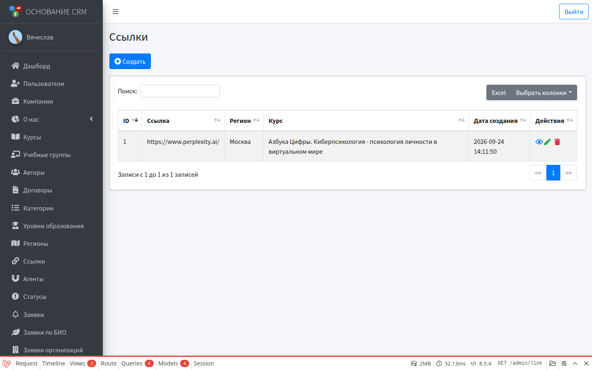

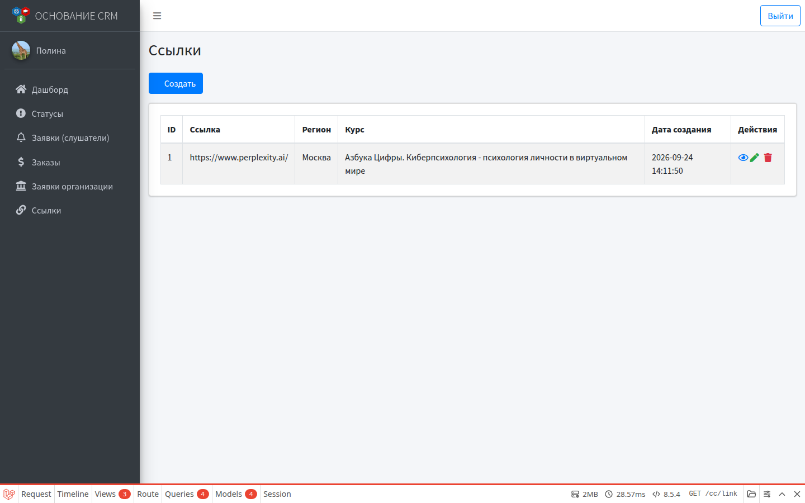

Пара: **регион + курс → URL**. При подаче обычной заявки система может подставить ссылку (например, на материалы/чат региона) в письмо или логику формы.

Создание: указать саму ссылку, регион и курс. Без пары регион+курс письмо может уйти без персональной ссылки.

---

## Агенты

**Меню:** Админка → **Агенты**

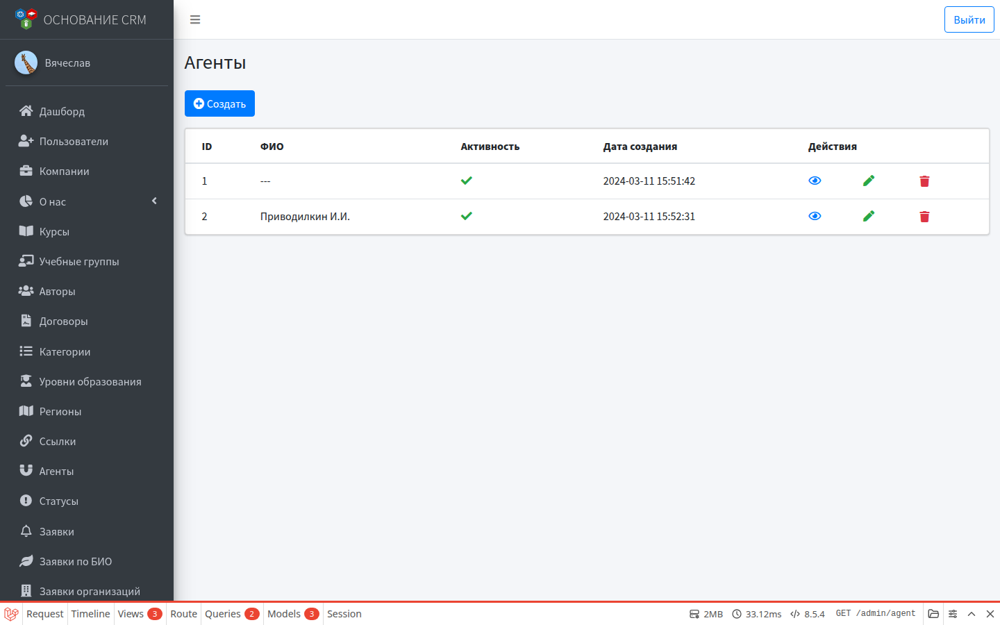

Справочник посредников для **платных заказов** (выбор на форме заказа).

- **ФИО / название** агента.
- Переключатель **Активность** — неактивные не предлагаются на сайте.

Не путать с ролью пользователя «Агент» (кабинет `/agent`) — это разные сущности: здесь справочник для поля заказа, там — учётная запись с отчётами.

---

## Компании

**Меню:** Админка → **Компании**

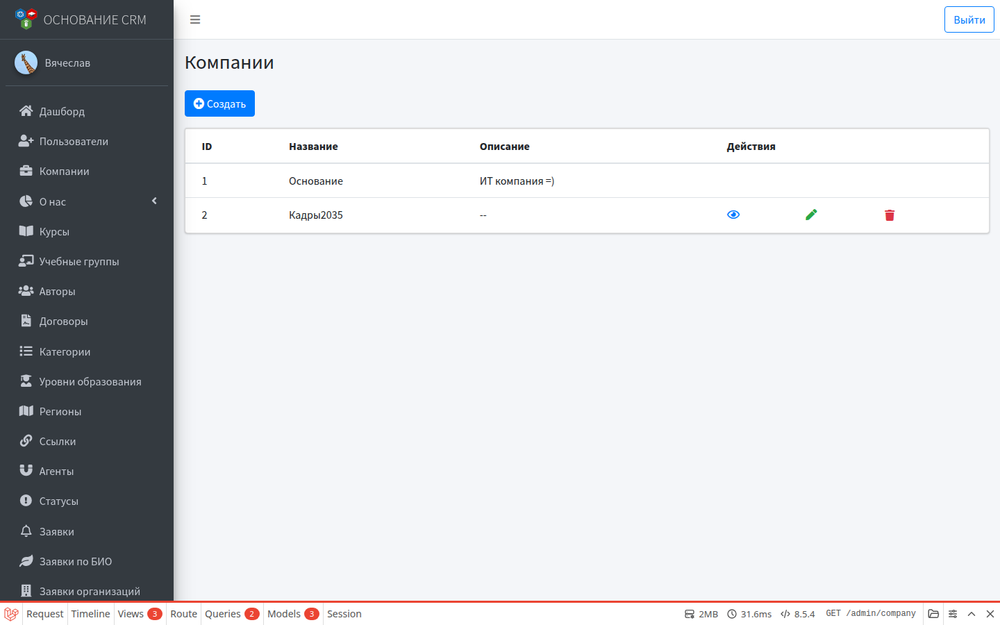

Провайдеры/площадки курсов. В карточке курса выбирается компания; от неё зависит, в каких каталогах сайт показывает программу.

---

## Категории

**Меню:** Админка → **Категории**

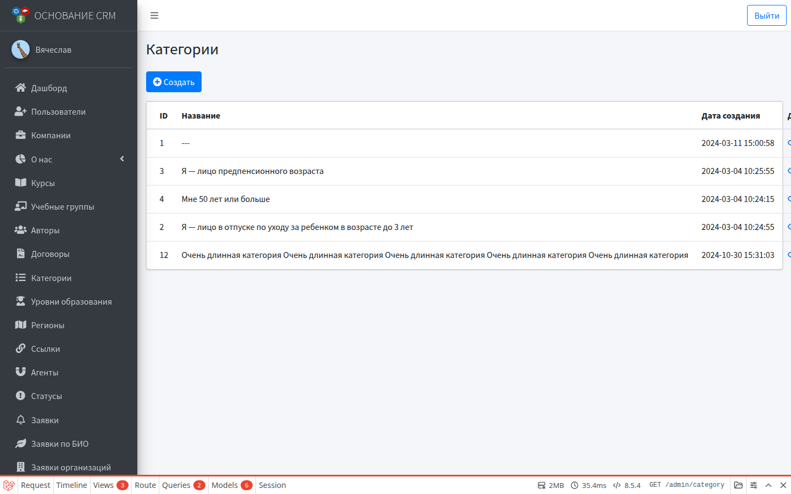

Справочник для поля «категория» в заявках слушателей (создание/редактирование заявки).

---

## Уровни образования

**Меню:** Админка → **Уровни образования**

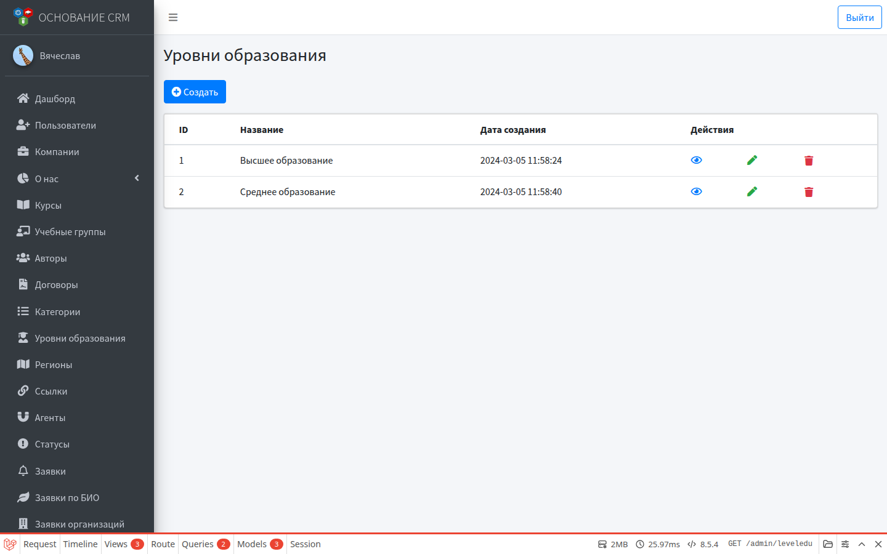

Справочник для поля образования в заявках.

---

## Регионы

**Меню:** Админка → **Регионы**

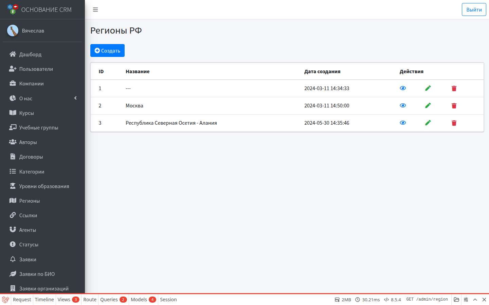

Нужны в заявках, заказах и в справочнике **Ссылки** (пара регион + курс).

---

## О нас и документы сайта

**Меню:** Админка → **О нас**

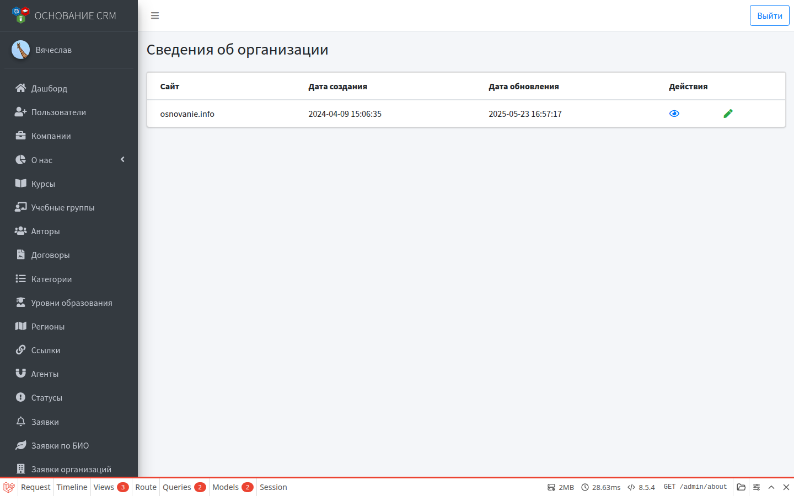

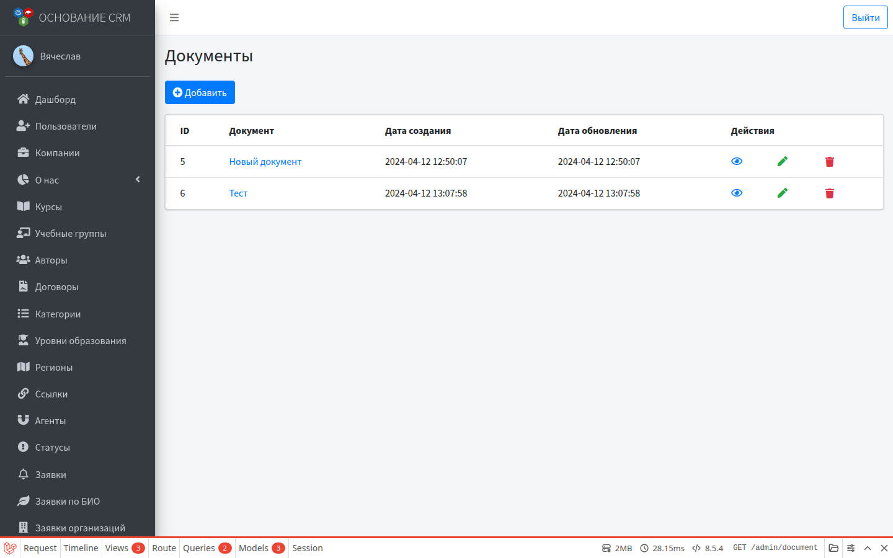

| Подпункт | Назначение |
| --- | --- |
| Основные сведения | Контент страницы «О нас» на сайте |
| Документы | Файлы/документы организации для публичной части |

Это не документы слушателя из ЛК и не файлы настроек биоэкономики.

---

## Как связаны справочники с работой

```text
Регион + Курс → Ссылка → письмо/логика заявки
Статус (заявка) → Заявки / org / default у бесплатного курса
Статус (order + code) → Заказы / default у платного / кнопки в ЛК
Агент (справочник) → поле на форме заказа
Категория, уровень образования → поля заявки
Компания → курс → витрина сайта
```

## Типичные ошибки

- Сменили цвет/название статуса заказа с кодом оплаты — в ЛК кнопка «Оплатить» пропала → код статуса должен совпадать с ожидаемым в системе.
- Нет ссылки в письме → не заведена запись в **Ссылках** для этой пары регион+курс.
- Агента не видно на форме заказа → выключена активность.

## Связанные разделы

- [Заявки](lids.md) · [Заказы](orders.md) · [Курсы](courses.md)  
- [Настройки](settings.md) · [Авторы и договоры](authors-contracts.md)  
