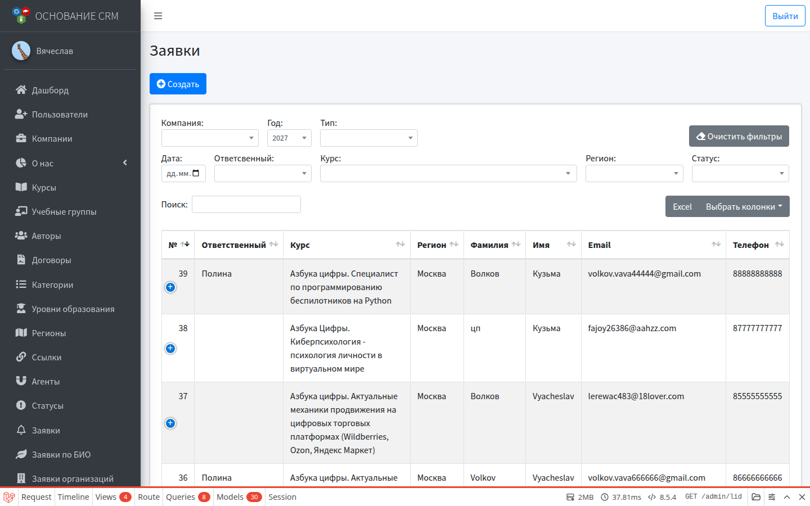
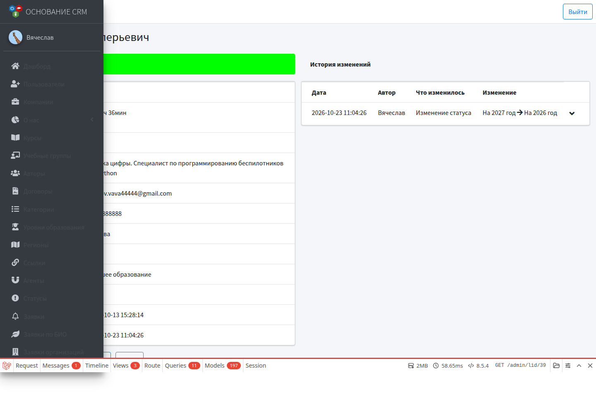

# Заявки (слушатели)

**Кому:** администратор, специалист КЦ  
**Меню:** Админка → **Заявки** · КЦ → **Заявки (слушатели)**

## Зачем раздел

Обычные заявки на обучение (не биоэкономика и не платный заказ): с сайта, с портала «Работа России» или созданные вручную сотрудником. Здесь меняют статус, назначают ответственного, правят данные и выгружают список в Excel.

Не путать с:

- **Заявки по БИО** — админ и КЦ, личные заявки биоэкономики;
- **Заявки организаций** — заявки от юрлица / организации;
- **Заказы** — платные программы.

## Откуда появляются заявки

| Источник | Как попадает |
| --- | --- |
| Сайт | Гость: **Оставить заявку** / форма курса (`/lid/create`) |
| Работа России | Тип заявки `rr` (фильтр «Тип» в списке) |
| Вручную | Кнопка **Создать** в списке заявок (админ или КЦ) |

Статус при создании с сайта обычно берётся из **статуса по умолчанию** у курса (если задан).

## Список

Общие фильтры (названия могут чуть отличаться у админа и КЦ):

- год, дата;
- тип (в т.ч. Работа России);
- ответственный, курс, регион, статус;
- у админа дополнительно — компания.

Фильтры сохраняются. **Очистить фильтры** сбрасывает их.

**Excel** — выгрузка с учётом текущих фильтров (кнопка над таблицей).

## Создать заявку вручную

1. **Создать**.
2. Заполните ФИО, дату рождения, телефон, email, курс, регион и остальные обязательные поля формы.
3. При необходимости отметьте «Работа России».
4. Сохраните — заявителю может уйти письмо о принятии заявки (если почта на стенде работает).

## Карточка и редактирование

**Просмотр:** статус (цветом), контакты, курс, регион, категория, образование, тип, время первой реакции, история изменений.

**Редактировать** — правка данных плюс блок:

| Поле | Смысл |
| --- | --- |
| Ответственный | Сотрудник, ведущий заявку |
| Статус | Текущий этап обработки |

При смене статуса система просит **комментарий** (модальное окно) — он попадает в историю изменений.

Список доступных статусов настраивается в справочнике **Статусы** (у заявок — статусы без типа «заказ»).

## Типичный рабочий цикл КЦ

1. Открыть список → отфильтровать новые / свой год / без ответственного.
2. Открыть заявку → взять в работу: назначить себя ответственным, сменить статус, при необходимости оставить комментарий.
3. Связаться с заявителем, уточнить данные в форме редактирования.
4. Довести статус до финального по вашему регламенту.
5. При необходимости выгрузить отбор в Excel.

## Типичные ошибки

- Ищете заявку биоэкономики здесь → смотрите **Заявки по БИО** или **Заявки организаций**, если это org-форма.
- Нет статуса по умолчанию у курса → новые заявки с сайта могут создаваться некорректно; задайте статус в карточке курса.
- В истории пусто после правки без смены статуса → комментарий к смене статуса пишется при изменении статуса.

## Связанные разделы

- Сценарий: [Обычная заявка с сайта до КЦ](../flows/lid-to-cc.md)  
- [Заявки организаций](orgs.md) · [Заказы](orders.md) · [Заявки по БИО](biolids.md)  
