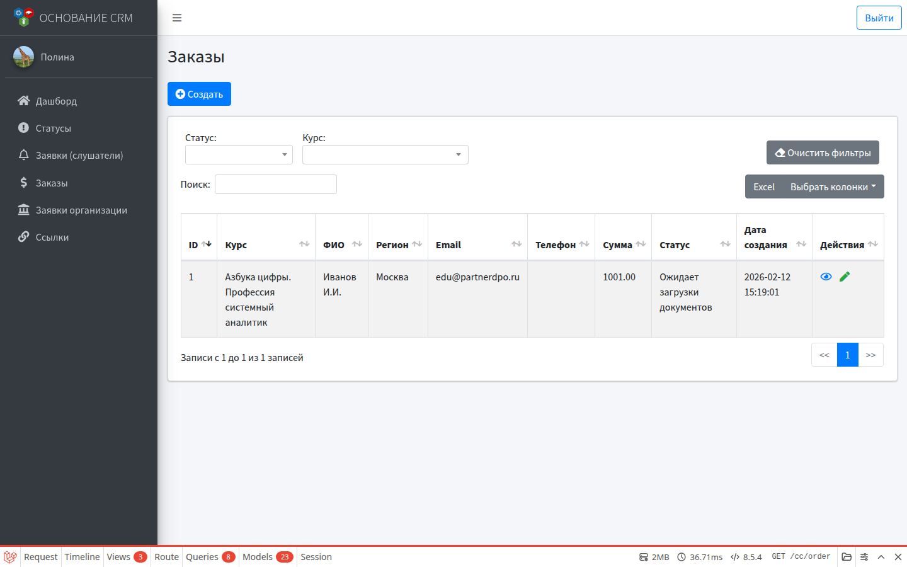
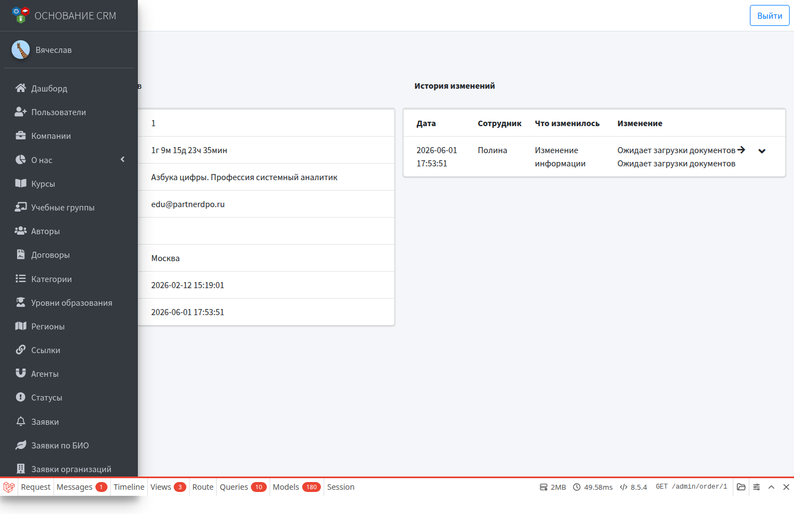

# Заказы

**Кому:** администратор, специалист КЦ  
**Меню:** Админка → **Заказы** · КЦ → **Заказы**

## Зачем раздел

Платные заказы на обучение: курс, слушатель (пользователь), сумма, статус, агент, UTM-метки. Статусы заказов — отдельные от статусов бесплатных заявок (в справочнике статусов тип «заказ»).

## Откуда появляются заказы

Основной путь — публичная форма заказа: страница платного курса → `/order/create/{course}`.

При оформлении с сайта система обычно:

1. Создаёт пользователя-слушателя (если email ещё не занят) и отправляет письмо с доступом и данными заказа.
2. Создаёт заказ со суммой из цены курса и **статусом по умолчанию** курса (для платного курса в карточке курса должен быть выбран статус заказа).
3. Фиксирует регион, агента (если выбран) и UTM.
4. Может уведомить сотрудников письмом о новом заказе.

Кнопка **Создать** в списке заказов CRM на текущий момент не является полноценным сценарием — заказы ведите с сайта или уточняйте у разработки, если нужен ручной ввод.

На курсе в торговом каталоге есть опции цены и **быстрой оплаты** (`fast_pay`) — они влияют на витрину/оплату; детали оплаты ЮKassa зависят от настроек стенда.

## Список

Фильтры: статус, курс (и сброс фильтров).

В таблице: ID, курс, ФИО, регион, email, телефон, агент, сумма, статус, дата, UTM, действия.

## Карточка

- Цветной статус.
- Номер, курс, контакты пользователя, регион, даты.
- Время первой реакции и история смены статусов / правок с комментариями.

## Редактирование

Доступно менять:

| Поле | Примечание |
| --- | --- |
| Сумма | Можно скорректировать |
| Ответственный | Обычно сотрудники КЦ |
| Статус | Статусы с типом «заказ» |

Курс, ФИО, телефон, email, регион на форме редактирования **только для просмотра** (правятся через карточку пользователя / иные процессы).

При смене статуса — комментарий в модальном окне → история.

## Рабочий цикл КЦ / админа

1. Новый заказ в списке (письмо сотрудникам, если настроено).
2. Назначить ответственного, сменить статус («в работе», «оплачен» и т.д. — по вашему справочнику).
3. При необходимости поправить сумму.
4. Слушатель входит в ЛК под выданными доступами и работает с документами заказа (см. сценарий и будущий модуль ЛК).

## Типичные ошибки

- Заказ с сайта не создаётся → у курса не задан **статус по умолчанию** для платного типа; проверьте цену и открытость записи.
- Email уже есть в системе → публичная форма может остановиться с сообщением о существующем пользователе (известное ограничение); разруливает администратор вручную.
- Путаете статусы заявок и заказов → в карточке курса для платного выбирайте статусы заказов.

## Связанные разделы

- Сценарий: [Платный заказ и документы](../flows/order-and-documents.md)  
- [Заявки (слушатели)](lids.md)  
- [Курсы](courses.md)  
