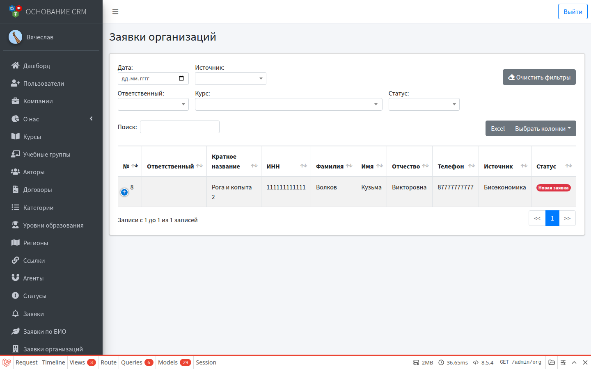
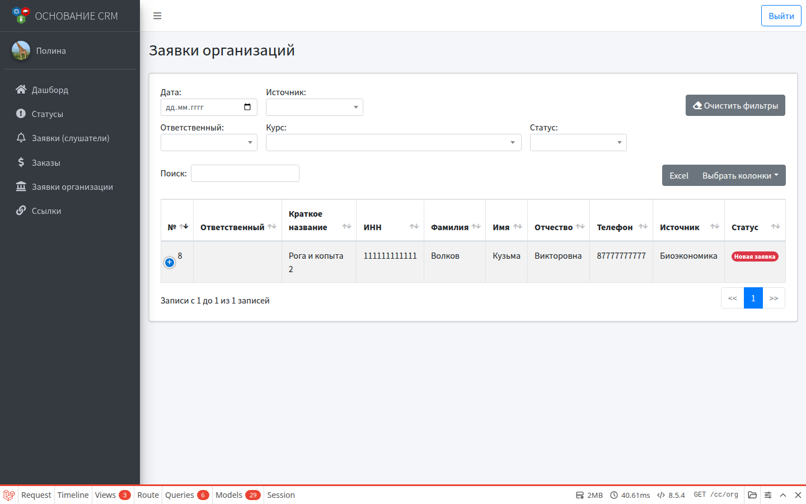
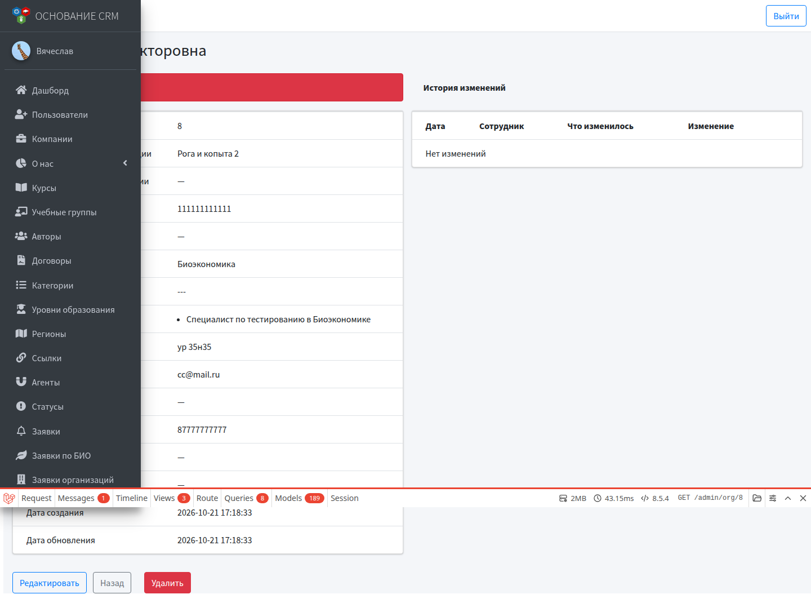

# Заявки организаций

**Кому:** администратор, специалист КЦ  
**Меню:** Админка → **Заявки организаций** · КЦ → **Заявки организации**

## Зачем раздел

Заявки от организаций (юрлицо / представитель): контакты организации, ИНН, выбранные курсы, статус обработки. Отдельный поток от личных заявок слушателей и от **Заявок по БИО**.

## Откуда появляются

| Источник | Форма на сайте | Как видно в списке |
| --- | --- | --- |
| Обычная заявка организации | `/org/create` | Источник пустой или иной |
| Биоэкономика (организация) | `/org/bioeconomy` | Источник **Биоэкономика** |

Фильтр **Источник → Биоэкономика** отбирает org-заявки с биоэкономики. Личные заявки БИО в этот список **не** попадают.

## Список

Фильтры:

- дата;
- источник (в т.ч. Биоэкономика);
- ответственный, курс, статус.

Как и в других списках, фильтры можно сбросить кнопкой **Очистить фильтры**.

В таблице: номер, ответственный, краткое название организации, ИНН, курсы, ФИО контакта, email, телефон, источник, статус, даты.

## Карточка

Показывает:

- статус;
- реквизиты организации (краткое/полное название, ИНН, адрес);
- источник;
- список выбранных курсов;
- комментарий заявителя;
- контакты (основные и дополнительные);
- регион;
- время первой реакции и историю изменений.

## Редактирование

1. Открыть заявку → **Редактировать** (или сразу из списка, если есть ссылка).
2. Можно править реквизиты организации, контакты, регион.
3. Назначить **ответственного** и сменить **статус**.
4. При смене статуса — комментарий в модальном окне (уходит в историю).
5. Курсы и комментарий заявителя на форме обычно только для просмотра.

## Рабочий цикл

1. Отфильтровать новые / биоэкономику / свой участок.
2. Взять в работу: ответственный + статус.
3. Уточнить ИНН, контакты, набор курсов с заявителем.
4. Довести до нужного статуса по регламенту.

Создание учётки слушателя и запись в учебную группу из **этой** заявки автоматически не выполняются — это сценарий личных заявок БИО и настроек курса.

## Типичные ошибки

- Ждёте пользователя и группу после org-формы биоэкономики → смотрите [сценарий БИО](../flows/bioeconomy-onboarding.md): автоматизация завязана на **личную** форму курса.
- Путаете с **Заявками** слушателей — другие меню и другая сущность.

## Связанные разделы

- [Заявки (слушатели)](lids.md)  
- [Заявки по БИО](biolids.md)  
- Сценарий: [Обычная заявка с сайта до КЦ](../flows/lid-to-cc.md) (рядом описан и org-поток)  
