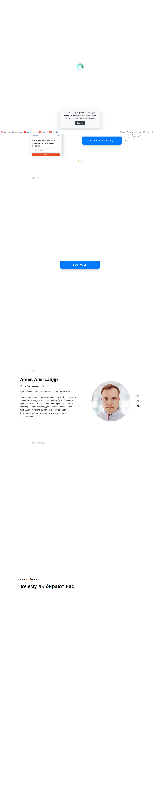
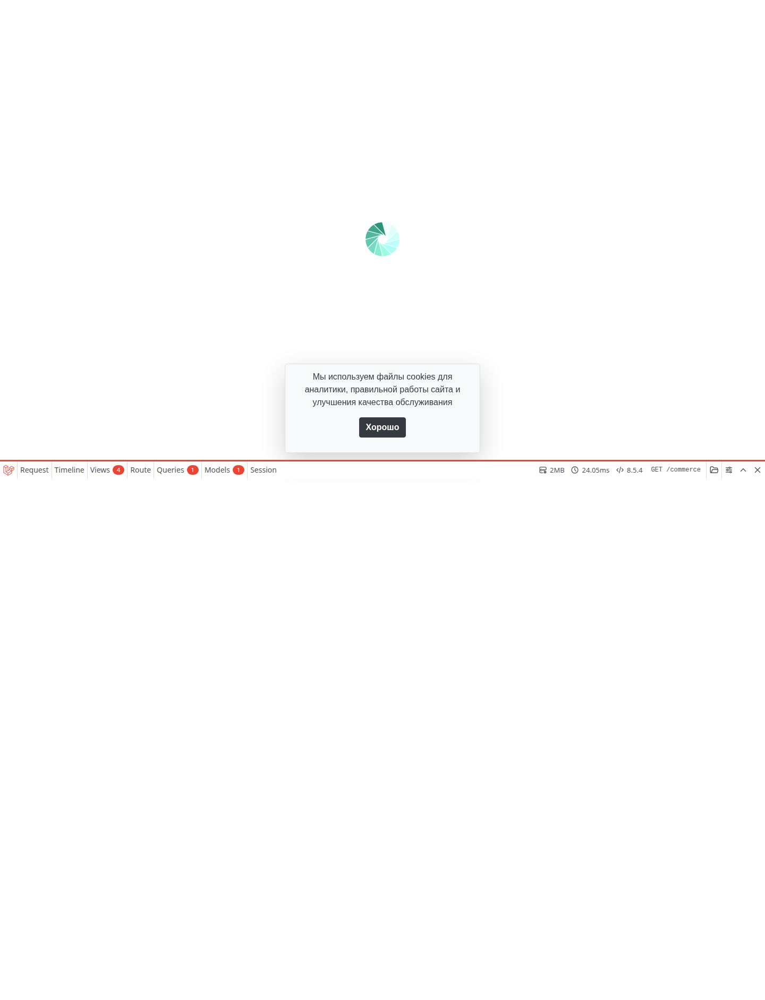
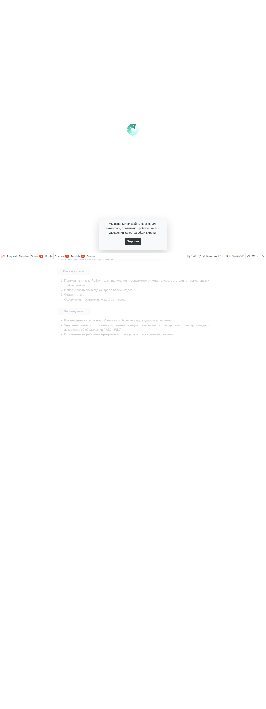
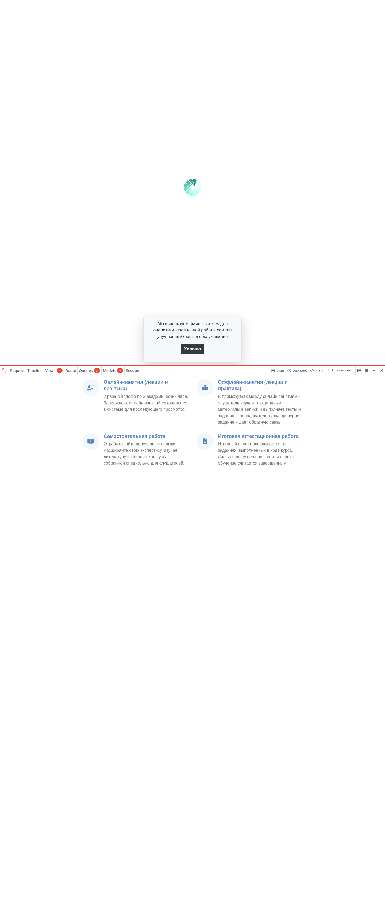
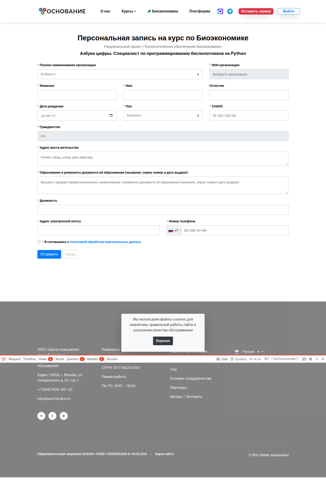
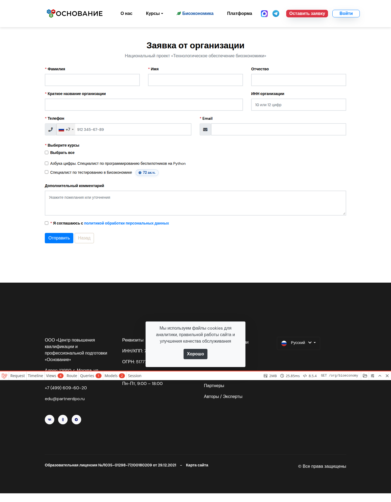

# Публичный сайт и формы

**Кому:** гость (и любой, кто смотрит сайт без входа в CRM)  
**Где:** страницы сайта без префиксов `/admin`, `/cc`, `/agent`, `/user`

## Зачем раздел

Как ориентироваться в меню, куда нажимать «записаться» и какую форму выбрать, чтобы заявка попала в нужный раздел CRM.

## Меню сайта

Типичные пункты шапки (актуальная вёрстка `main2`):

| Пункт | Что открывает |
| --- | --- |
| О нас | Сведения об организации |
| Курсы → Бесплатные (АМСЗ) | Каталог бесплатных программ |
| Курсы → Профессии будущего | Платные / софинансирование |
| Курсы → Архив | Архивные программы |
| Биоэкономика | Курсы с флагом биоэкономики + документы проекта |
| Платформа | Внешний LMS (`lms.osnovanie.info`) — отдельный вход |
| Оставить заявку | Зависит от страницы (см. ниже) |
| Войти | Вход в кабинет / CRM по роли |

Соцсети и каналы (MAX, Telegram и т.п.) — в шапке/подвале для подписки на новости наборов.

## Каталоги курсов

На сайт попадают **опубликованные** курсы нужного типа:

| Раздел | Какие курсы |
| --- | --- |
| Бесплатные | Без цены, не «код будущего», не биоэкономика |
| Платные / профессии будущего | С указанной ценой |
| Код будущего | С флагом «код будущего» (если раздел снова включён в меню) |
| Биоэкономика | С флагом **Биоэкономика** |
| Архив | Архивные карточки |

Карточка курса (`/course/{id}`): описание, авторы, кнопка записи.

## Какую форму выбрать

| Цель | Куда идти | Куда попадёт в CRM |
| --- | --- | --- |
| Бесплатное обучение (личная заявка) | **Оставить заявку** или **Записаться** на карточке бесплатного курса → `/lid/create` | **Заявки** |
| Платный курс | **Записаться** на карточке платного курса → `/order/create/{course}` | **Заказы** + учётка слушателя |
| Биоэкономика, лично | Карточка курса БИО → кнопка личной записи → `/lid/bioeconomy/{course}` | **Заявки по БИО** |
| Биоэкономика, от организации | Раздел Биоэкономика → **Оставить заявку от организации** → `/org/bioeconomy` | **Заявки организаций** (источник «Биоэкономика») |
| Обычная заявка организации | `/org/create` | **Заявки организаций** |

На странице биоэкономики кнопка в шапке по умолчанию ведёт на **организационную** форму. Личная заявка БИО — через карточку конкретного курса.

Подробные сценарии:

- [Обычная заявка → КЦ](../flows/lid-to-cc.md)  
- [Биоэкономика](../flows/bioeconomy-onboarding.md)  
- [Платный заказ](../flows/order-and-documents.md)  

## Карточка курса: кнопка «Записаться»

| Курс | Действие кнопки |
| --- | --- |
| Обычный бесплатный | Форма заявки с подставленным курсом |
| С ценой | Форма заказа |
| Биоэкономика | Личная форма заявки БИО |

Если запись закрыта или набор закончился, на витрине может показываться сообщение о завершении набора и ссылки на каналы.

## После отправки формы

- Личная / org-заявка → страница благодарности (`/lid/thank`, `/org/thank`).
- Заказ → экран завершения с данными доступа (если учётка создана).
- На формах может быть **Yandex SmartCaptcha** (включается в Админка → Настройки → **Формы**).
- Слишком частая отправка ограничена (защита от спама).

## Информационные страницы

- **О нас**, услуги, видео, гид — контентные страницы.
- На биоэкономике дополнительно скачиваются файлы, загруженные админом в **Настройки → Биоэкономика**.
- `sitemap.xml` — для поисковиков.

## Типичные ошибки гостя

- Оставил org-заявку на биоэкономику, а ждёт личный кабинет и группу → нужна **личная** форма курса; org идёт в заявки организаций без автоматики ЛК.
- Не находит курс → не опубликован, другая витрина (бесплатные / платные / БИО) или запись закрыта.
- Не проходит форма → капча, обязательные поля, или лимит попыток; подождите и попробуйте снова.

## Связанные разделы

- [Личный кабинет слушателя](user-cabinet.md)  
- [Курсы](courses.md) (настройки публикации и записи)  
