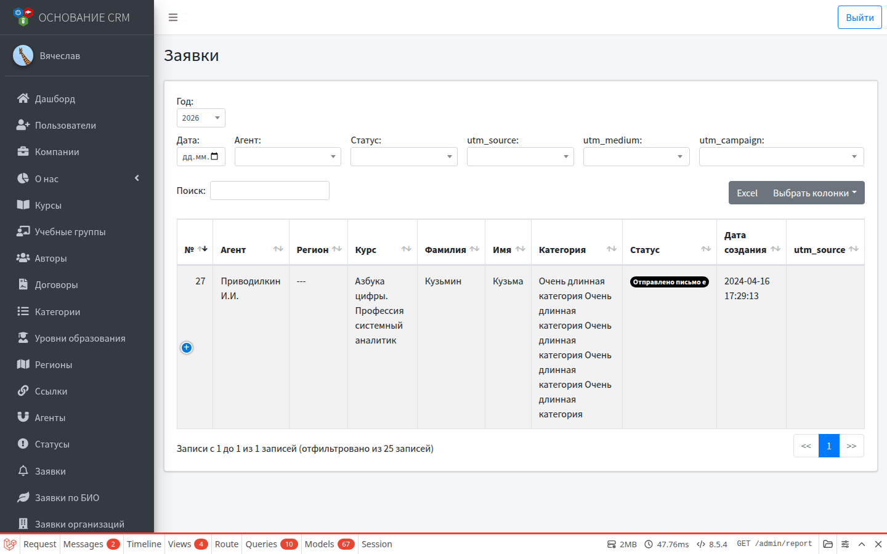

# Отчёты

**Кому:** администратор (полный отчёт); агент — свой срез в кабинете агента  
**Меню:** Админка → **Отчеты** · Агент → **Отчеты**

## Зачем раздел

Сводка по заявкам слушателей с фильтрами (год, агент, статус, UTM) и выгрузкой в Excel. Это отчёт по **заявкам (lids)**, не по заказам и не по БИО.

## Админ: Отчеты

### Фильтры

- год (по умолчанию — год из настроек);
- дата;
- агент (справочник);
- статус;
- utm_source / utm_medium / utm_campaign.

### Таблица

Типичные колонки: номер, агент, регион, курс, поток, ФИО, email, категория, статус, дата, UTM, год.

Данные подгружаются с учётом фильтров. Поиск по таблице — стандартный DataTables.

### Excel

Кнопка **Excel** над таблицей выгружает отчёт с текущими фильтрами и сортировкой в файл `Report.xlsx`.

### Рабочий цикл

1. Выставить год и нужные UTM/агента.
2. Просмотреть строки в таблице.
3. При необходимости скачать Excel для внешней обработки.

---

## Агент: свой отчёт

См. [Кабинет агента](agent.md). Список строится только по заявкам, связанным с **привязанными агентами** и/или **utm_source** пользователя. Фильтры уже, Excel может отличаться по набору кнопок — ориентируйтесь на экран кабинета.

---

## Другие выгрузки (не этот раздел)

| Что нужно | Куда |
| --- | --- |
| Список обычных заявок | **Заявки** → Excel |
| Анкета группы БИО | **Заявки по БИО** → «Сформировать анкету» |
| Заказы | Раздел **Заказы** (отдельный список) |

---

## Типичные ошибки

- Пустой отчёт при выбранном агенте → у заявок не проставлен этот агент / другие UTM.
- «Не тот» год → смените фильтр года или год по умолчанию в настройках.
- Ждёте заказы в отчёте → заказы смотрите в **Заказах**, не здесь.

## Связанные разделы

- [Заявки](lids.md) · [Справочники](dictionaries.md) (агенты)  
- [Пользователи](users.md) · [Кабинет агента](agent.md)  
