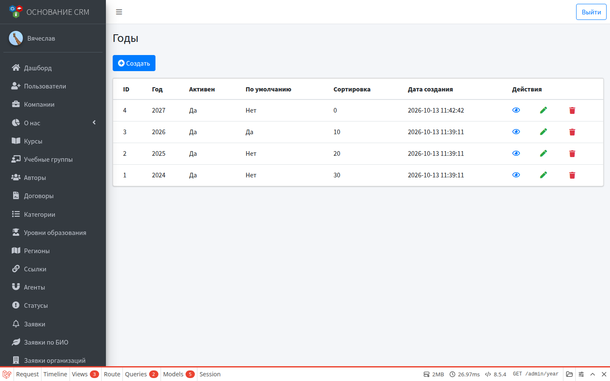
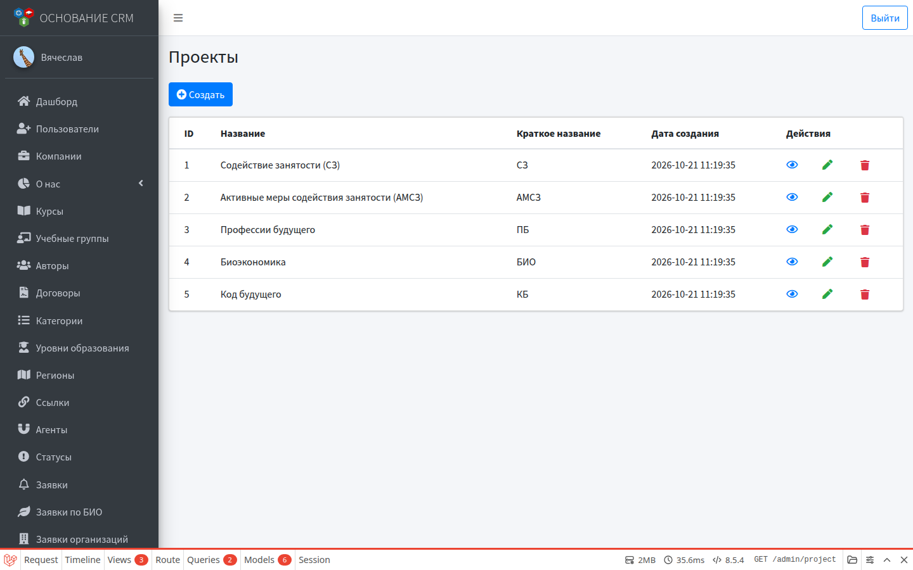
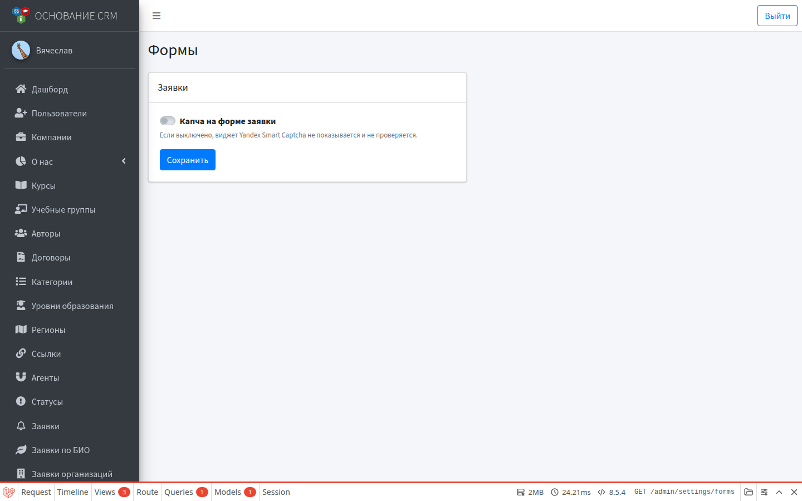
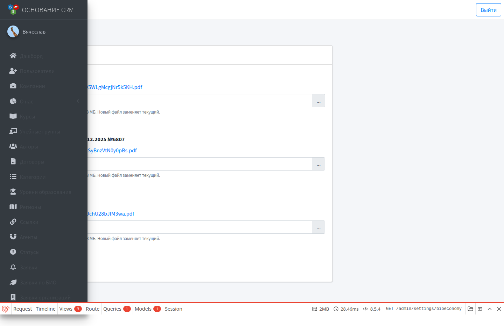

# Настройки

**Кому:** администратор  
**Меню:** Админка → **Настройки** → Годы / Проекты / Формы / Биоэкономика

## Зачем раздел

Параметры, которые влияют на фильтры, договоры и публичные формы, но не являются ежедневной «операционкой» по заявкам.

---

## Годы

**Настройки → Годы**

Справочник учебных/отчётных годов для фильтров заявок и поля года у курса.

При создании/редактировании:

| Поле | Смысл |
| --- | --- |
| Год | Числовое значение (например 2026) |
| Сортировка | Порядок в списках |
| Активен | Показывать ли в выборе |
| По умолчанию | Какой год подставляется в фильтрах списков заявок |

Обычно один год отмечен «по умолчанию». При смене набора обновите год по умолчанию, чтобы КЦ сразу видело актуальный период.

---

## Проекты

**Настройки → Проекты**

Нужны для **договоров с авторами**.

| Поле | Смысл |
| --- | --- |
| Название | Полное имя проекта |
| Краткое название | До 5 символов, верхний регистр — в фильтрах договоров |
| Формулировка в договоре | Текст после «(далее – Программа)» в PDF; можно пусто |

Сценарий: завести проект → выбрать его при создании договора → при смене формулировки править здесь и заново скачать PDF.

Подробнее: [Авторы и договоры](authors-contracts.md).

---

## Формы

**Настройки → Формы**

Сейчас: переключатель **Капча на форме заявки** (Yandex Smart Captcha).

- Включено — виджет показывается и проверяется на форме заявки.
- Выключено — капча не мешает отправке (удобно на тестовом стенде).

Для работы капчи на проде нужен серверный ключ в окружении (`YANDEX_SMARTCAPTCHA_KEY` и клиентские настройки стенда).

---

## Биоэкономика

**Настройки → Биоэкономика**

Файлы для публичной страницы `/bioeconomy` (не путать с документами слушателя в ЛК):

| Документ | Назначение на сайте |
| --- | --- |
| Презентация проекта | Скачиваемый файл |
| Приказ Минпромторга… | Скачиваемый файл |
| Список программ | Скачиваемый файл |

Загрузка: выбрать файл → **Сохранить**. Новый файл заменяет текущий. Можно отметить удаление текущего файла.

Форматы: pdf, doc, docx, ppt, pptx, xls, xlsx (до большого лимита размера — см. подсказку на форме).

Автоматика заявок БИО (группа, письма, создание пользователя) настраивается **в карточке курса**, не здесь.

---

## Что сюда не входит

| Нужно | Куда идти |
| --- | --- |
| Статусы, регионы, агенты, ссылки | [Справочники](dictionaries.md) |
| Учебные группы, курсы | Соответствующие модули |
| Пользователи CRM | Модуль пользователей (отдельный) |
| Ключи ЮKassa / почты / ботов | Конфигурация сервера (`.env`), не экран настроек |

---

## Типичные ошибки

- В фильтрах заявок «не тот» год → смените год **по умолчанию** или выберите нужный в фильтре.
- На биоэкономике нет файлов → ничего не загружено или файл удалён чекбоксом.
- Капча «ломает» тест → временно выключите в **Формах**; на проде лучше оставить включённой.

## Связанные разделы

- [Публичный сайт](public-site.md) · [Курсы](courses.md) · [Авторы и договоры](authors-contracts.md)  
