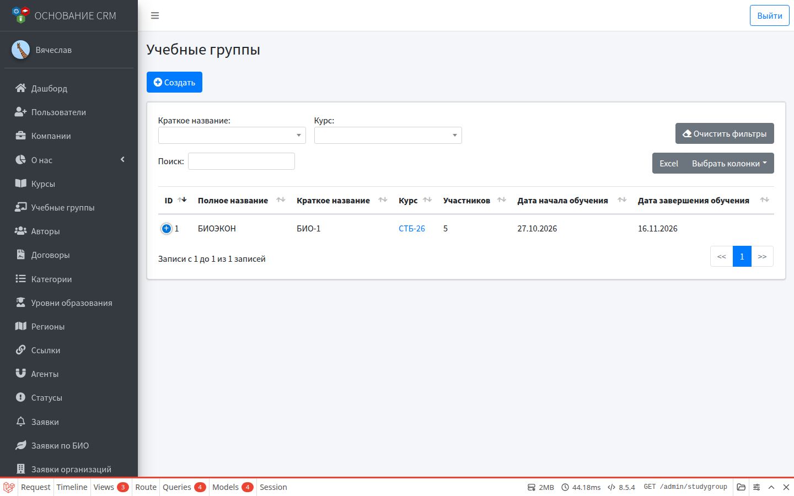
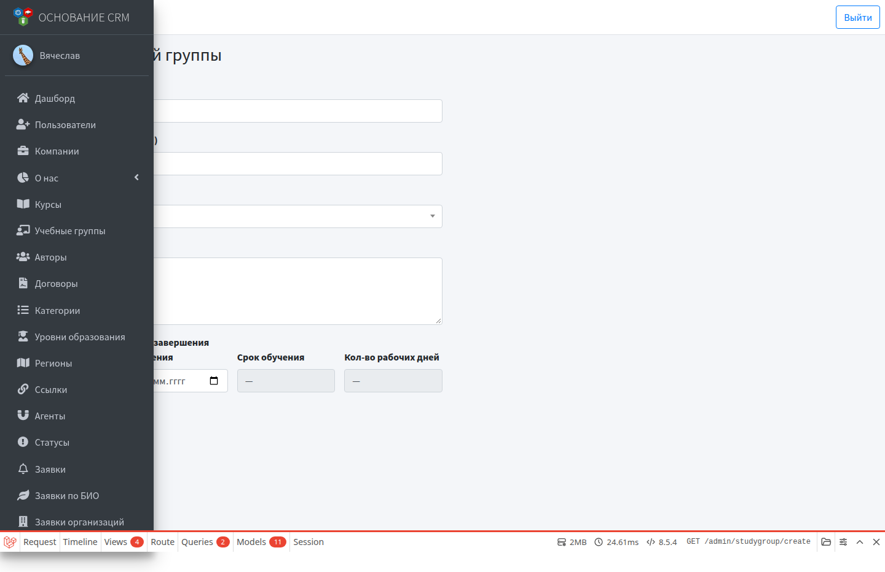
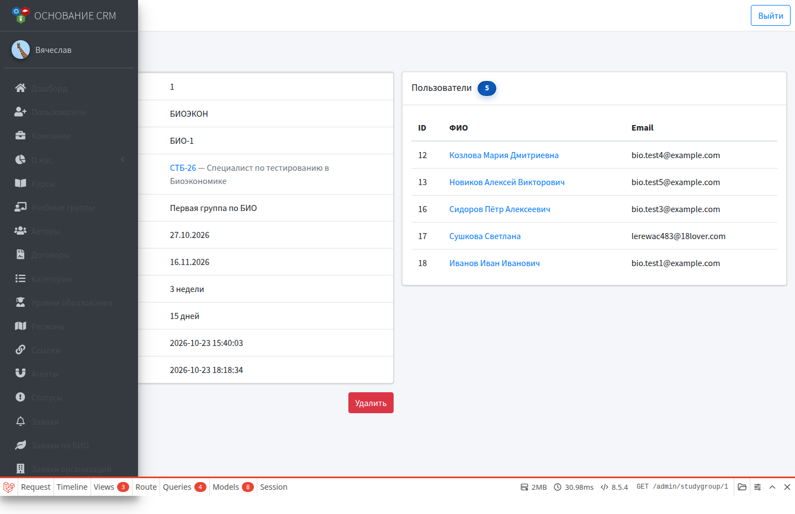

# Учебные группы

**Кому:** администратор  
**Меню:** Админка → **Учебные группы**

## Зачем раздел

Набор слушателей на конкретный поток курса: даты обучения, краткое имя для отчётов (АРПМ), список пользователей в группе. Группа нужна, чтобы автоматически или вручную записывать слушателей из заявок по БИО.

## Основные поля

| Поле | Смысл |
| --- | --- |
| Полное название | Как группа отображается в CRM |
| Краткое название (для АРПМ) | Короткий код/имя в фильтрах и выгрузках |
| Курс | Привязка к курсу; без неё группа не появится в автоматизации этого курса |
| Даты начала / завершения | По ним система считает срок обучения и число рабочих дней (справочно) |
| Описание | Произвольный текст |

## Создать группу

### Предусловия

Курс уже создан (хотя бы сохранён в каталоге).

### Шаги

1. **Учебные группы** → создать.

2. Укажите полное название; при необходимости — краткое.
3. В поле **Курс** выберите нужную программу.
4. Задайте даты начала и окончания при необходимости (срок и рабочие дни посчитаются сами).
5. Сохраните.

После сохранения группу можно выбрать в карточке курса: **Биоэкономика → Учебная группа для заявок**.

## Карточка группы

На странице просмотра:

- реквизиты группы и ссылка на курс;
- список **пользователей** в группе (ФИО, email) со счётчиком.

Слушатели попадают сюда:

- автоматически при создании заявки по БИО, если в курсе выбрана эта группа и включено создание пользователя;
- вручную: массово из списка заявок БИО («Создать пользователей» + выбор группы) или через карточку пользователя (учебные группы в профиле).

## Редактировать / удалить

- **Редактировать** — можно сменить курс, название, даты. Если группа была выбрана в автоматизации курса, после смены курса проверьте настройки курса.
- **Удалить** — с подтверждением. Удалённая группа больше не должна выбираться в автоматизации.

## Типичные ошибки

- Группа есть, но в курсе её нет в списке → в группе не выбран этот курс (или выбран другой).
- Слушатель не появился в группе после заявки → в курсе не выбрана группа и/или выключено «Создавать пользователя», либо заявка не личная БИО с сайта (см. сценарий).

## Связанные разделы

- [Курсы](courses.md)  
- [Заявки по БИО](biolids.md)  
- Сценарий: [Запуск курса по биоэкономике](../flows/bioeconomy-onboarding.md)  
