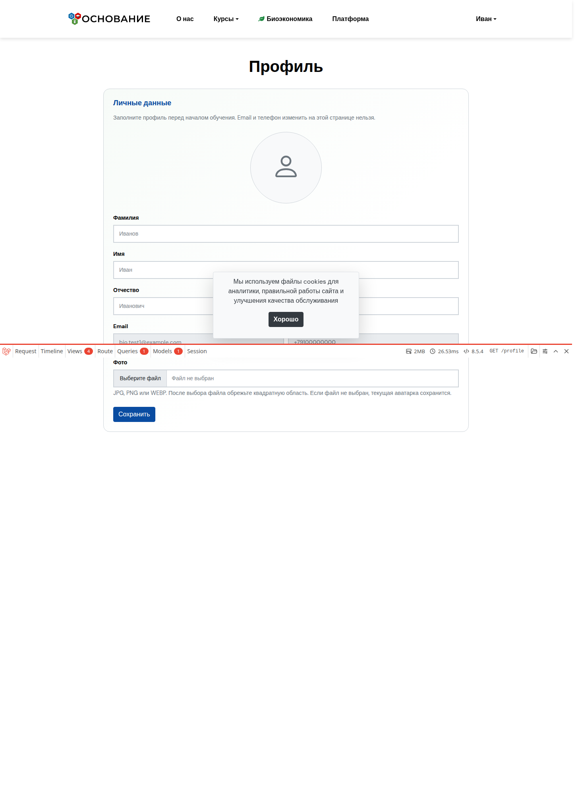
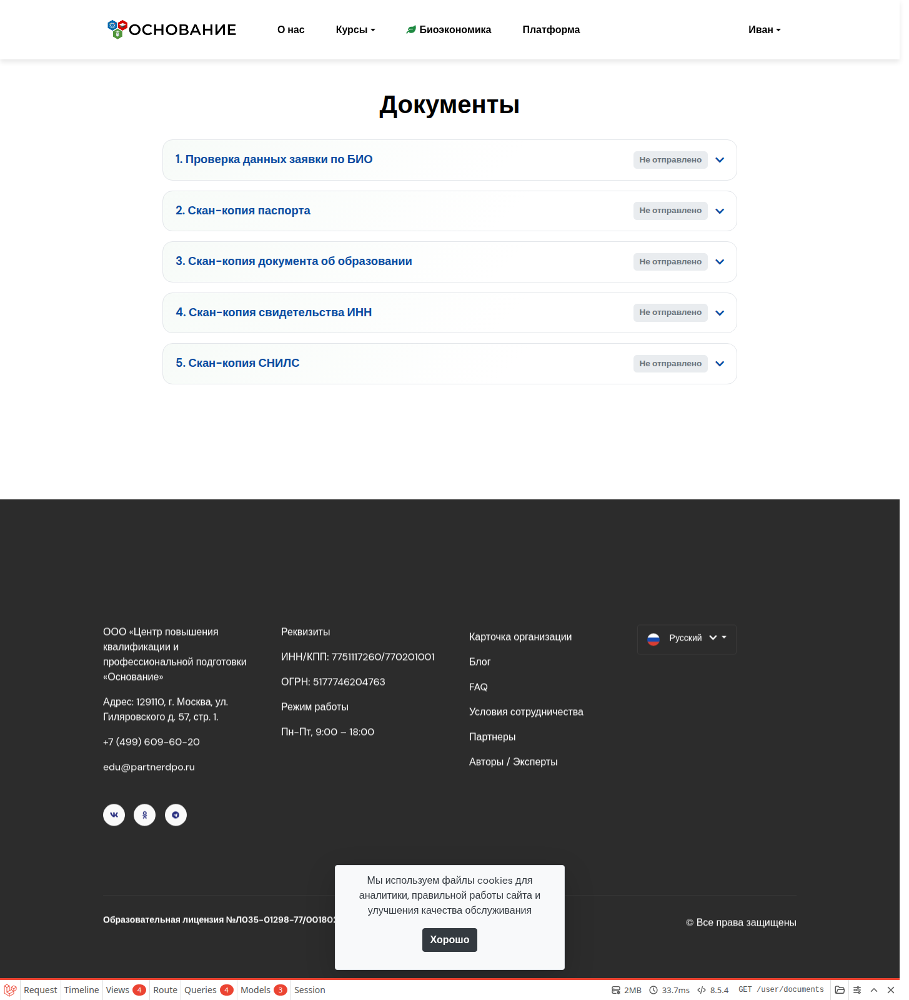
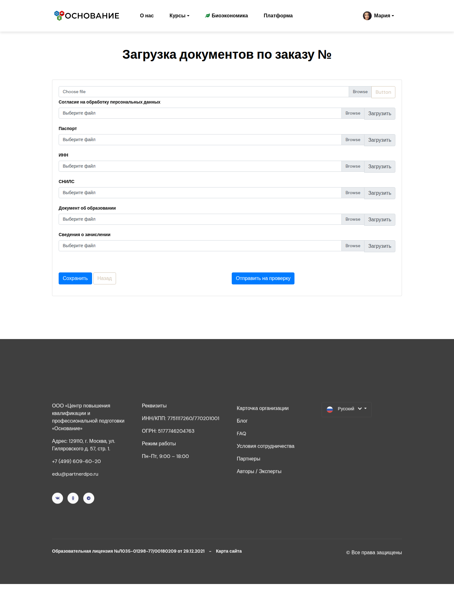

# Личный кабинет слушателя

**Кому:** пользователь (роль «Пользователь» / слушатель)  
**Где:** `/user` после входа; общий профиль — `/profile`

## Зачем раздел

Заполнить профиль, загрузить документы по биоэкономике или по заказу, при необходимости оплатить заказ. Учётку обычно создаёт администратор или автоматика (заявка БИО / платный заказ); саморегистрации нет.

## Вход

1. На сайте — **Войти**.
2. Email и пароль из письма или от администратора.
3. После входа слушатель попадает в `/user` (личный кабинет).

Если роль другая (админ, КЦ, агент) — откроется соответствующая CRM-панель, не этот кабинет.

Подробнее: [Роли и вход](../00-roles-and-login.md).

## Главная ЛК (`/user`)

На экране:

1. Приветствие и напоминание заполнить профиль и документы.
2. Быстрые ссылки: **Профиль**, **Документы**.
3. Блок **Отклонённые документы** (если проверка БИО вернула отказ) — причина и переход к загрузке заново.
4. Таблица **Мои заказы** (если есть платные заказы):

| Статус заказа (код) | Что можно сделать в ЛК |
| --- | --- |
| `payment-allowed` | Кнопка **Оплатить** (ЮKassa) |
| `waiting-documents` | **Загрузить документы** → `/user/docs/{order}` |

Остальные статусы отображаются без этих кнопок — ждите действий сотрудников или смены статуса в CRM.

## Профиль (`/profile`)

Доступен всем авторизованным ролям; у слушателя удобно открывать с главной ЛК.

Можно изменить:

- фамилию, имя, отчество;
- аватар (загрузка / обрезка).

Email и телефон на форме как правило **только для просмотра** — правки через администратора.

Кнопка «домой» из профиля ведёт в зону роли (для слушателя — снова в ЛК).

## Документы по биоэкономике (`/user/documents`)

Раздел для слушателей с **привязанной заявкой по БИО**.

Если заявки нет: сообщение, что к учётке пока не привязана заявка БИО — обратитесь к администратору или оформите личную заявку на курс.

### Если заявка есть

**1. Проверка данных заявки**

- Просмотрите ФИО, контакты, организацию, курс и другие поля из заявки.
- Нажмите отправку данных на проверку.
- Статусы: не отправлено / на проверке / проверено / отклонено (с причиной).
- Пока на проверке или уже принято — повторно отправить нельзя; после отклонения можно отправить снова.

**2. Скан-копии документов**

Ожидаются (форматы pdf, jpg, jpeg, png):

- паспорт;
- документ об образовании;
- свидетельство ИНН;
- СНИЛС.

По каждому файлу: загрузить → статус проверки. Принятые и «на проверке» повторно не отправляются; отклонённые — загрузить исправленный файл.

Проверяет администратор или КЦ в карточке **Заявки по БИО**.

## Документы по заказу (`/user/docs/{order}`)

Отдельный набор для платного потока (когда статус заказа позволяет загрузку), например:

- согласие на обработку ПДн;
- паспорт, ИНН, СНИЛС;
- документ об образовании;
- сведения о зачислении (xls/xlsx).

Файлы привязываются к заказу. Это не тот же экран, что документы БИО.

## Оплата

Если у заказа статус с кодом `payment-allowed`, на главной ЛК появляется **Оплатить**. После оплаты статус меняется по настройкам платёжного callback (ЮKassa). При сбое оплаты — напишите в поддержку / КЦ и проверьте статус заказа в CRM.

## Типичные ошибки

| Симптом | Что проверить |
| --- | --- |
| Пустой блок документов БИО | Нет привязки `user_id` у заявки БИО |
| Нет заказов в таблице | Заказ оформлен на другой email / другую учётку |
| Нет кнопки «Оплатить» | Статус заказа ещё не `payment-allowed` |
| Документ «уже на проверке» | Дождитесь решения или исправьте после отклонения |
| Не помню пароль | Письмо с доступом или сброс / админ |

## Связанные разделы

- [Публичный сайт и формы](public-site.md)  
- [Заявки по БИО](biolids.md) · [Заказы](orders.md)  
- Сценарии: [биоэкономика](../flows/bioeconomy-onboarding.md), [заказ](../flows/order-and-documents.md)  
