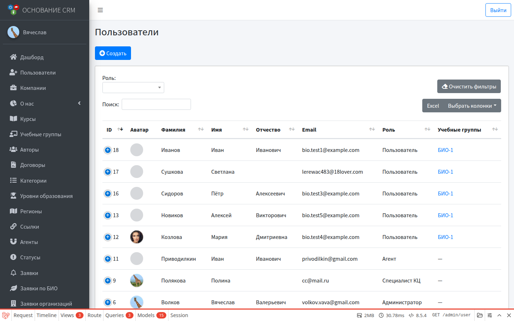
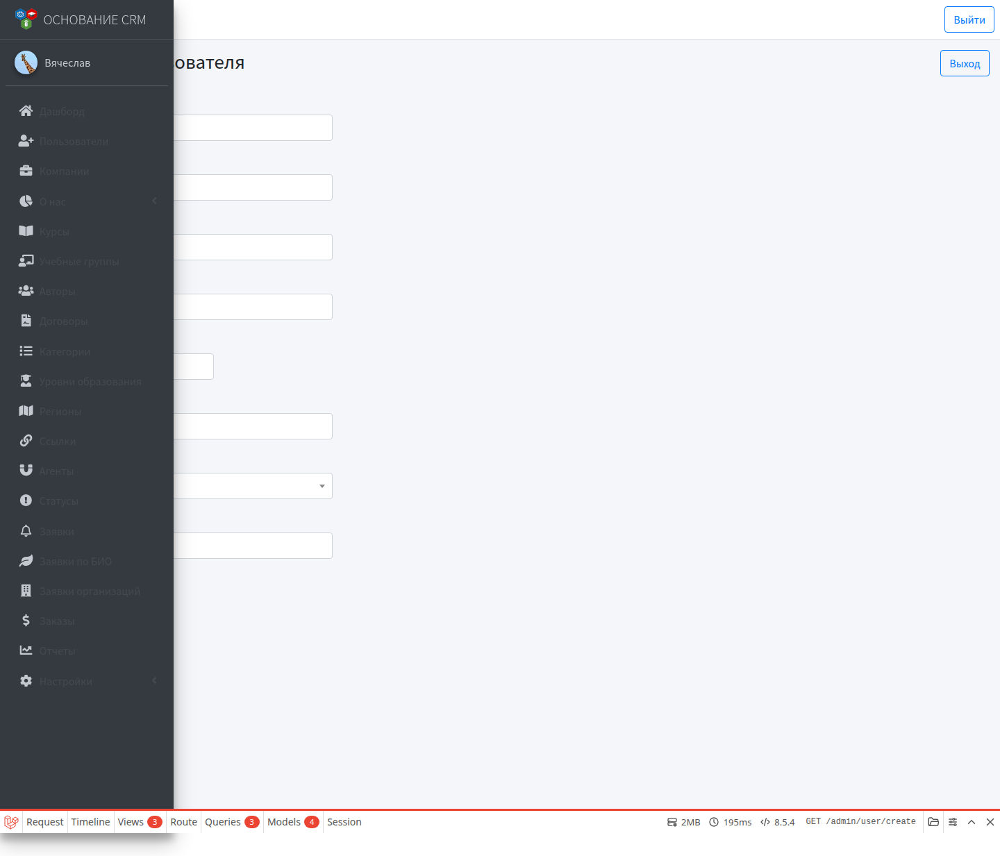
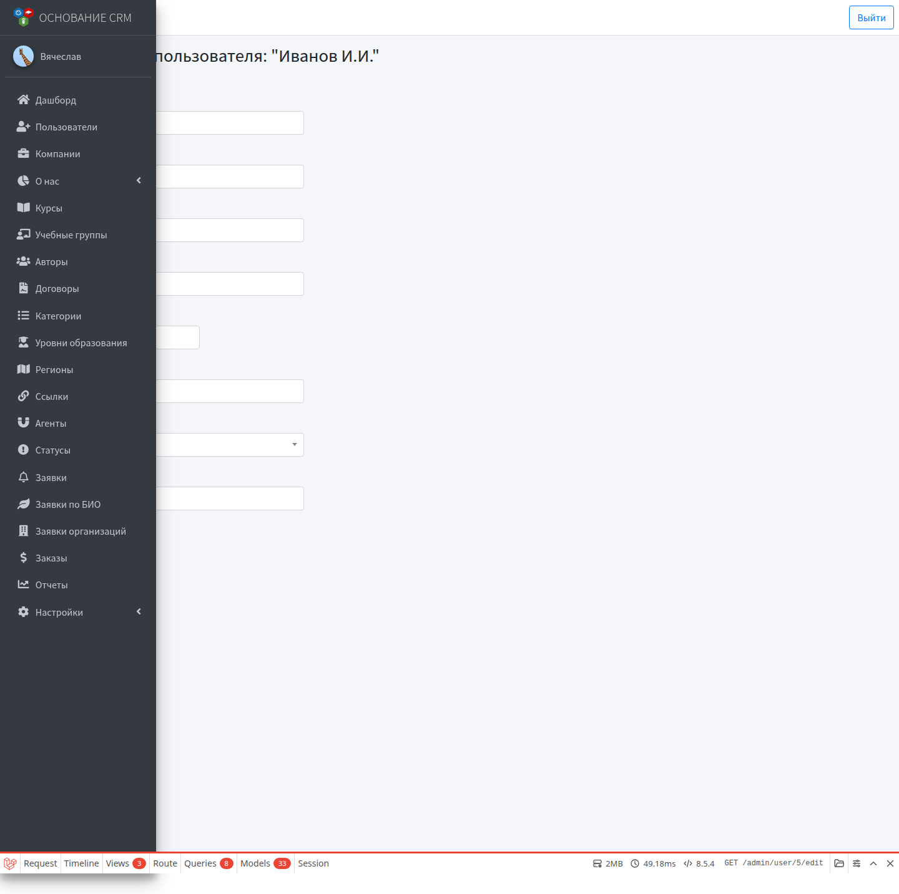

# Пользователи CRM

**Кому:** администратор  
**Меню:** Админка → **Пользователи**

## Зачем раздел

Учётные записи всех ролей: администраторы, специалисты КЦ, агенты (роль), слушатели. Саморегистрации нет — создаёт админ или автоматика (заказ / заявка БИО).

Не путать:

- роль **Агент** (вход в `/agent`) и справочник **Агенты** (поле на форме заказа) — см. [Справочники](dictionaries.md);
- слушателя из автоматики БИО — его тоже можно найти и править здесь.

## Список

Фильтр по роли. В таблице: аватар, ФИО, email, роль, учебные группы, даты.

Действия в строке:

| Действие | Смысл |
| --- | --- |
| Просмотр | Карточка |
| Редактировать | Данные, роль, пароль, группы… |
| Заблокировать / разблокировать | Значок «запрет» / «открыть»; себя заблокировать нельзя |
| Удалить | Удаление учётной записи |

Заблокированный пользователь помечен бейджем; **войти в систему не сможет**.

## Создать пользователя

1. **Пользователи → Создать**.
2. ФИО, email, телефон, пароль.
3. Выберите **роль**.
4. Дополнительно по роли:
   - **Специалист КЦ** — можно указать компанию;
   - учебные группы — мультивыбор (актуально для слушателей).
5. Сохраните и передайте доступы человеку (письмо вручную или через процессы БИО/заказа).

Привязку к справочным агентам и utm_source для роли «Агент» удобнее задать при **редактировании** (см. ниже).

## Редактировать

Те же поля, что при создании; пароль можно оставить пустым — тогда не меняется.

Для роли **Агент** появляются:

| Поле | Зачем |
| --- | --- |
| Привязка к агенту | Какие записи из справочника **Агенты** видит в своём отчёте |
| utm_source | Дополнительно заявки с этими UTM попадают в отчёт агента |

Для **КЦ** — поле компании (если используется разделением по площадкам).

**Учебные группы** — список групп слушателя; можно править вручную рядом с автоматикой БИО.

## Карточка

Краткие сведения: роль, группы, даты. Отсюда — редактирование или удаление.

## Типичные сценарии

| Задача | Шаги |
| --- | --- |
| Завести сотрудника КЦ | Создать → роль «Специалист КЦ» → пароль → передать логин |
| Завести агента с отчётом | Создать → роль «Агент» → редактировать → привязать агентов/utm |
| Слушатель без автоматики | Создать → роль «Пользователь» → группы при необходимости |
| Отозвать доступ | Заблокировать (предпочтительнее удаления, если нужны история и связи) |

## Типичные ошибки

- Агент вошёл, но отчёт пустой → не привязаны справочные агенты и/или utm в карточке пользователя.
- Слушатель есть в заявке БИО, но «нет в пользователях» → автоматика не создала учётку; создайте вручную или кнопкой в заявке БИО.
- Путаете справочник агентов и роль агента → справочник для заказов; роль — для кабинета `/agent`.

## Связанные разделы

- [Роли и вход](../00-roles-and-login.md)  
- [Учебные группы](study-groups.md) · [Заявки по БИО](biolids.md)  
- [Кабинет агента](agent.md) · [Отчёты](reports.md)  
